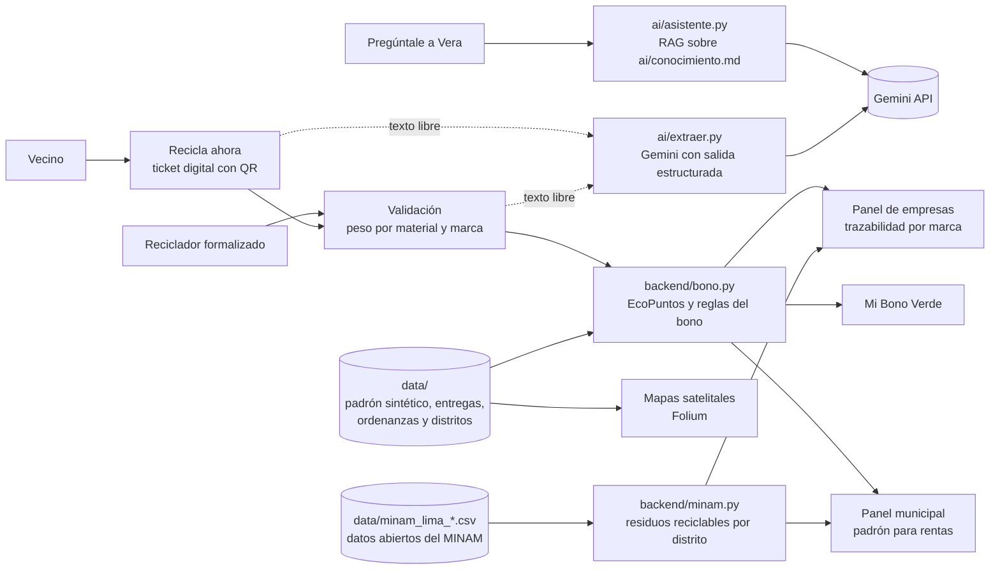

# Minka

*Juntos, cada aporte cuenta.*

> **Digitalizamos el Bono Verde municipal para que los vecinos que reciclan obtengan su descuento en arbitrios, las municipalidades lo administren sin papel y las empresas recuperen sus envases con trazabilidad por marca.**

| | |
|---|---|
| Demo pública | https://reciclagov-peru.streamlit.app/ |
| Video de respaldo | *(enlace pendiente)* |
| Founder | Ana Karen Zamalloa Lima |
| Curso | Proyecto final de la Diplomatura de Ciencia de Datos para las Ciencias Sociales y la Gestión Pública, Q-Lab PUCP, 2026 |

---

## 1. One-liner

Minka digitaliza el Bono Verde municipal para que los vecinos que separan sus residuos reciban su descuento en arbitrios, mediante un ticket digital que valida un reciclador formalizado y que alimenta, a su vez, el padrón municipal y la trazabilidad de envases que financian las empresas.

## 2. Founder


**Ana Karen Zamalloa Lima.** Comunicadora para el desarrollo y especialista en Gestión Pública por la PUCP, predocente del curso Medio Ambiente y Sostenibilidad, con experiencia en proyectos vinculados al medio ambiente, el desarrollo sostenible y la gestión pública.

*Dirige el producto, el diseño y la relación con municipalidades y empresas, en tanto que Claude Code actúa como su socio técnico en la ingeniería del software.*

## 3. Problema

### 3.1 Relevancia ambiental del reciclaje domiciliario

La generación de residuos sólidos constituye uno de los desafíos ambientales más persistentes de las ciudades. Según el Banco Mundial, el planeta generó 2,010 millones de toneladas de residuos sólidos municipales en 2016 y, de mantenerse las tendencias actuales, dicha cifra alcanzaría los 3,400 millones de toneladas hacia 2050, con un crecimiento especialmente acelerado en los países de ingresos medios (Kaza et al., 2018). En el caso particular de los envases plásticos, cerca de un tercio escapa de los sistemas de recolección y termina en el ambiente (Ellen MacArthur Foundation, 2016). En consecuencia, la separación en la fuente y el reciclaje no solo reducen la presión sobre los rellenos sanitarios, sino que también devuelven materiales a la economía y disminuyen la extracción de recursos vírgenes.

El Perú refleja este desafío con particular intensidad. En 2016 se generaron más de siete millones de toneladas de residuos sólidos municipales urbanos y, sin embargo, solo se recicló el 1.9 % de los residuos reaprovechables (Ministerio del Ambiente [MINAM], s. f.). Asimismo, la Defensoría del Pueblo (2019) advierte que alrededor del 70 % de los residuos municipales proviene de los domicilios, de modo que el hogar constituye el punto de partida de cualquier política de reciclaje. Los datos abiertos del MINAM confirman esta oportunidad a escala distrital, puesto que en 2023 los hogares de Lurigancho-Chosica generaron 60,193 toneladas de residuos, de las cuales cerca de 24 de cada 100 correspondían a materiales reciclables como papel, cartón, plásticos, vidrio y metales (MINAM, 2024a).

### 3.2 Quién lo sufre

El problema afecta a tres actores de manera simultánea. En primer lugar, a los **vecinos de los distritos de Lima que cuentan con un programa de segregación en la fuente**, quienes tienen derecho a un descuento en arbitrios que, en la práctica, desconocen o no pueden acreditar. En segundo lugar, a las **subgerencias de limpieza pública y de gestión ambiental de las municipalidades distritales**, que administran el incentivo con tickets físicos, padrones elaborados casa por casa y cruces manuales con el área de rentas. Finalmente, a las **empresas productoras de envases**, que deben demostrar la recuperación de material posconsumo y que, no obstante, carecen de información verificable sobre el origen y la marca de lo que se recicla. A estos actores se suman los **recicladores**, cuya labor sostiene buena parte de la recuperación de materiales en las ciudades latinoamericanas, aunque con frecuencia permanece invisible y mal remunerada (Dias, 2016; Medina, 2007).

### 3.3 Cuánto les cuesta

El artículo 70 del Decreto Legislativo N.° 1278, modificado por el Decreto Legislativo N.° 1501, faculta a las municipalidades a otorgar incentivos a quienes segregan sus residuos (Presidencia de la República del Perú, 2016, 2020). No obstante, el mecanismo funciona en papel. En Villa María del Triunfo, por ejemplo, el vecino debe reunir tickets físicos entregados por el reciclador autorizado para acceder a un descuento de 20 % en el arbitrio de limpieza pública (Municipalidad Distrital de Villa María del Triunfo, 2016). Este procedimiento genera tres costos concretos. Por un lado, el vecino pierde el beneficio cuando extravía un ticket o cuando ignora que el programa existe. Por otro lado, la municipalidad destina horas de personal a consolidar padrones y a verificar entregas sin un registro estandarizado. Además, el Estado carece de información agregada, puesto que el ente rector desconoce qué municipalidades aplican el incentivo y con qué resultados.

### 3.4 Cómo se resuelve hoy

Actualmente, el incentivo se gestiona mediante tickets de papel, hojas de cálculo elaboradas por cada municipalidad y comunicaciones informales por WhatsApp entre recicladores y supervisores. Por su parte, las empresas recurren a acuerdos con acopiadores que reportan toneladas totales, sin distinguir la marca de los envases.

### 3.5 Evidencia de tres conversaciones

Con el fin de validar el problema desde la perspectiva de cada actor, se sostuvieron tres conversaciones semiestructuradas con usuarios potenciales, cuyas notas completas se encuentran en [`docs/research/`](docs/research/).

| Conversación | Actor | Hallazgo principal |
|---|---|---|
| [Especialista en residuos sólidos del MINAM](docs/research/01_especialista_minam.md) | Estado, ente rector | Cada municipalidad administra el Bono Verde según su propio criterio y no reporta al ministerio, de modo que el ente rector no sabe qué municipalidades lo aplican. |
| [Coordinadora de sostenibilidad de una empresa cervecera](docs/research/02_sostenibilidad_cervecera.md) | Empresa productora de envases | La empresa solo valora la recuperación de sus propios envases, por lo cual la trazabilidad por marca constituye la condición para que pague. |
| [Vecina de Villa María del Triunfo](docs/research/03_vecina_villa_maria.md) | Ciudadanía | Pese a que su distrito aprobó el incentivo en 2016, la vecina no sabe cómo funciona y en su hogar no se recicla. |

La lectura conjunta de las tres conversaciones permite identificar un mismo vacío desde tres ángulos. En primer lugar, el especialista del MINAM confirmó que el ministerio se concentra en la dimensión normativa y en la capacitación, mientras que la administración del incentivo queda en manos de cada municipalidad sin un procedimiento común ni un reporte al ente rector (G. Miranda, comunicación personal, 10 de noviembre de 2026). En segundo lugar, la coordinadora de sostenibilidad señaló que a su empresa le interesa que retorne lo que salió al mercado, razón por la cual el material de otras marcas no contribuye a sus indicadores (coordinadora de sostenibilidad de una empresa cervecera, comunicación personal, 10 de noviembre de 2026). Finalmente, la vecina de Villa María del Triunfo recordó vagamente la existencia de un descuento por reciclaje, pero afirmó que en su casa no reciclan porque no saben cómo funciona el programa (vecina de Villa María del Triunfo, comunicación personal, 10 de noviembre de 2026). En síntesis, el incentivo existe en la norma, aunque no llega al vecino, no genera datos para el Estado y no ofrece a las empresas la trazabilidad que necesitan para financiarlo.

## 4. Solución e insight

### 4.1 Qué construimos

Minka es una aplicación web que conecta a los cuatro actores del Bono Verde en un solo flujo.

1. **El vecino** registra los materiales que separó, ya sea marcándolos o describiéndolos con sus propias palabras, indica la marca de los envases y obtiene un ticket digital con código QR.
2. **El reciclador formalizado** escanea o busca el ticket, pesa cada material y valida la entrega, de modo que su trabajo queda registrado.
3. **El vecino** visualiza en la sección Mi Bono Verde lo que puede ganar, es decir, su descuento mensual en arbitrios y los premios que puede canjear con sus EcoPuntos, así como la participación de su barrio.
4. **La municipalidad** descarga el padrón de beneficiarios listo para el área de rentas y compara el piloto con los residuos reales del distrito según el MINAM.
5. **La empresa** consulta cuántos kilos de sus propias marcas se recuperaron, en qué distritos de Lima conviene invertir según los datos del MINAM y descarga su certificado de trazabilidad.

Asimismo, la aplicación incluye un mapa que informa al vecino si su distrito premia el reciclaje, un asistente conversacional, Vera, que responde dudas sobre el Bono Verde, y una sección de registro en la que cada actor elige su plan y solicita su incorporación. El vecino se identifica con el código de contribuyente de su recibo de arbitrios, mientras que el reciclador lo hace con el carné que le otorga su municipalidad conforme a la Ley N.° 29419 (Congreso de la República del Perú, 2009).

### 4.2 Fundamentos teóricos

El diseño de Minka se sustenta en tres líneas de la literatura sobre el comportamiento de reciclaje.

**Incentivos económicos.** La economía ambiental sostiene que el reciclaje domiciliario genera beneficios sociales que el hogar no internaliza por sí mismo, lo cual justifica la intervención pública mediante incentivos (Kinnaman, 2006). En esa línea, Lu y Wang (2022) compararon cuatro tipos de incentivos en dos experimentos con residentes chinos y encontraron que el incentivo monetario fue el más efectivo para motivar la participación en el reciclaje, por encima de los incentivos de encuadre ambiental, institucionales y morales. El descuento en arbitrios constituye, precisamente, un incentivo monetario respaldado por la norma peruana.

**Normas sociales y retroalimentación.** Schultz (1999) demostró en un experimento de campo que informar a los hogares sobre su propio desempeño y el de su vecindario incrementa la participación en el reciclaje. De manera consistente, la revisión sistemática con metaanálisis de Varotto y Spagnolli (2017) identificó a la retroalimentación y a las normas sociales entre las estrategias psicológicas con efectos positivos en intervenciones de campo, mientras que Lu y Wang (2022) hallaron que las normas descriptivas moderan positivamente el efecto de los incentivos. Por ello, Minka muestra al vecino cuántos hogares de su sector ya reciclan y cómo se compara con el promedio de su barrio.

**Digitalización e inclusión de los recicladores.** Zhou et al. (2021) evaluaron un sistema digital de incentivos para residuos reciclables domiciliarios en Shanghái y reportaron un incremento de 229.3 % en la cantidad recolectada en una comunidad piloto. Por otra parte, la literatura sobre recicladores de base subraya que su integración formal en los sistemas municipales mejora tanto la recuperación de materiales como sus condiciones de trabajo (Dias, 2016; Medina, 2007). En consecuencia, Minka asigna al reciclador formalizado el rol de validar cada entrega, de modo que su labor queda registrada y reconocida.

### 4.3 Antecedentes y benchmarking

La revisión de experiencias internacionales y nacionales muestra que los incentivos al reciclaje y la responsabilidad del productor avanzan en distintas regiones, aunque ninguna de ellas articula el incentivo tributario municipal con la trazabilidad por marca.

| Experiencia | Qué hace | Lección para Minka |
|---|---|---|
| Unión Europea | El Reglamento (UE) 2025/40 obliga a los Estados miembros a contar con sistemas de depósito y devolución para botellas plásticas y latas de bebidas y a recolectar al menos el 90 % de estos envases a partir de 2029 (Parlamento Europeo y Consejo de la Unión Europea, 2025). | La trazabilidad de los envases y la responsabilidad del productor se convierten en obligaciones regulatorias. |
| España | RECICLOS, desarrollado por Ecoembes, es un sistema de devolución y recompensa en el que el ciudadano escanea sus latas y botellas con una aplicación web y códigos QR y recibe puntos canjeables por recompensas sociales y ambientales (Ecoembes, 2021). | Las recompensas digitales y la alianza con los municipios son viables a gran escala. |
| Chile | La Ley N.° 20.920 establece la responsabilidad extendida del productor, con metas de recolección y valorización para envases y embalajes (Congreso Nacional de Chile, 2016). | Las empresas financian la recolección cuando la norma les asigna metas verificables. |
| Colombia | La Resolución 1407 de 2018 obliga a los productores a formular planes de gestión ambiental de residuos de envases y empaques con metas de aprovechamiento (Ministerio de Ambiente y Desarrollo Sostenible, 2018). | Los productores requieren evidencia del aprovechamiento de sus envases. |
| Perú, sector público | Villa El Salvador aplica el Bono Verde desde 2004, San Juan de Lurigancho creó el Ecobono en 2016 y Lurigancho-Chosica aprobó en 2024 un descuento de 15 % para los participantes de su Programa Recicla (Municipalidad Distrital de Lurigancho, 2024; Municipalidad Distrital de Villa El Salvador, s. f.; El Popular, 2016). | El incentivo tributario existe, pero se administra en papel y sin datos agregados. |
| Perú, sector privado | TuPoinT, creada en 2022, otorga puntos por cada botella reciclada que pueden canjearse por descuentos en negocios afiliados (Infomercado, s. f.). | Existe disposición ciudadana a reciclar a cambio de beneficios, aunque sin vínculo con la municipalidad. |

### 4.4 Valor agregado

Las aplicaciones de reciclaje con puntos premian al vecino con descuentos comerciales, mientras que las municipalidades ya disponen de un incentivo legal más potente, el descuento en arbitrios, que no logran administrar. En consecuencia, el insight de Minka consiste en que **el mismo registro digital que el vecino necesita para acreditar su descuento es el dato que la municipalidad necesita para su padrón y el que la empresa necesita para demostrar la recuperación de sus envases**. A partir de esta idea, el valor agregado de Minka se expresa en cuatro dimensiones.

1. **Integración con un incentivo público existente.** A diferencia de TuPoinT o RECICLOS, Minka no crea un premio paralelo, sino que digitaliza el descuento en arbitrios que la ley ya permite, y lo complementa con premios financiados por las empresas.
2. **Trazabilidad por marca validada por un tercero.** Cada entrega registra el material, la marca, el sector y el reciclador que la pesó, lo cual responde a la condición planteada por la empresa entrevistada.
3. **Información pública para el Estado.** Los registros agregados y anonimizados permiten a las municipalidades y al MINAM conocer quién aplica el incentivo y con qué resultados, un vacío que el propio ente rector reconoció.
4. **Reconocimiento del reciclador formalizado.** El reciclador deja de ser un actor invisible y se convierte en el validador del sistema, en coherencia con la Ley N.° 29419 y con la literatura sobre inclusión de recicladores.

## 5. Why now

Tres condiciones hacen posible esta solución hoy y no hace tres años.

1. **Marco normativo.** El Decreto Legislativo N.° 1501 de 2020 reforzó la facultad municipal de incentivar la segregación, mientras que la Ley N.° 30884 (Congreso de la República del Perú, 2018) exige que las botellas de PET incorporen un porcentaje mínimo de material reciclado posconsumo, lo cual obliga a las empresas a asegurar abastecimiento verificable. A ello se suma la tendencia internacional hacia la responsabilidad extendida del productor, expresada en el Reglamento (UE) 2025/40 y en las leyes de Chile y Colombia descritas en el apartado 4.3.
2. **Costo de la inteligencia artificial.** Los modelos de lenguaje con salidas estructuradas permiten convertir un mensaje informal del vecino, como "tres botellas de Inca Kola y un cartón", en un registro con material, cantidad y marca, a un costo de fracciones de céntimo por consulta.
3. **Adopción digital.** El uso del celular y de los códigos QR se generalizó en el Perú a partir de los pagos digitales, de modo que un ticket digital ya no representa una barrera para el vecino ni para el reciclador.

## 6. Demo

**URL pública.** https://reciclagov-peru.streamlit.app/

La demo emplea datos reales y datos sintéticos. Por un lado, son reales las ordenanzas municipales, los límites distritales de Lima, el catálogo de marcas y los datos abiertos del Ministerio del Ambiente sobre la generación y la composición de los residuos domiciliarios de los 51 distritos de Lima Metropolitana y el Callao entre 2019 y 2023 (MINAM, 2024a, 2024b). Por otro lado, el padrón de viviendas y el historial de entregas de Lurigancho-Chosica son sintéticos, con el fin de no utilizar datos personales de vecinos reales.

### Flujo principal en tres capturas

| 1. El vecino genera su ticket | 2. El reciclador valida | 3. El vecino recibe su Bono Verde |
|---|---|---|
|  |  |  |

### Arquitectura



### Modelos y servicios

| Componente | Herramienta | Razón de la elección |
|---|---|---|
| Lectura del código QR del ticket | OpenCV | Permite que el reciclador escanee el ticket con la cámara del celular o desde una foto, sin instalar otra aplicación. |
| Lectura del mensaje del vecino | Gemini Flash (`gemini-flash-latest`) con un esquema de Pydantic | Devuelve material, cantidad y marca en un formato fijo, tiene un nivel gratuito suficiente para el piloto y un costo bajo a escala. Si la API no responde, un extractor de reglas propio garantiza que el flujo continúe. |
| Asistente Vera | Recuperación por palabras clave más generación con Gemini | Responde solo con la base de conocimiento del proyecto, lo cual reduce el riesgo de respuestas inventadas sobre normas o descuentos. |
| Mapas | Folium con imágenes satelitales de Esri y GeoJSON de distritos | Permite reconocer el propio barrio y ubicar los programas municipales vigentes. |
| Interfaz | Streamlit | Facilita un despliegue gratuito en Streamlit Community Cloud. |
| Transcripción de entrevistas | Whisper en la laptop de la autora | Las grabaciones contienen datos personales de terceros, por lo que no debían salir de la computadora local. |

### Cómo correrlo en local

```bash
git clone https://github.com/anakaren-zl/reciclagov.git
cd reciclagov
cp .env.example .env    # opcional, para activar Gemini con una clave propia
uv run --python 3.12 --with-requirements requirements.txt python -m streamlit run app/streamlit_app.py
```

La aplicación funciona aun sin clave de Gemini, dado que el extractor de reglas y la búsqueda en la base de conocimiento actúan como respaldo.

## 7. Modelo de negocio

### Quién paga

El modelo es mixto. La municipalidad adopta la herramienta sin costo, puesto que la barrera presupuestal y de contratación pública frenaría su adopción, mientras que **las empresas productoras de envases pagan por la trazabilidad de sus propias marcas**. Una parte de ese pago financia premios adicionales para los vecinos.

### Planes

| Plan | Cliente | Precio | Incluye |
|---|---|---|---|
| Municipal | Municipalidad distrital | S/ 0 | Ticket digital, validación por recicladores, tablero y padrón de beneficiarios para rentas |
| Trazabilidad | Empresa de envases | S/ 150 por tonelada de envases de sus marcas | Certificado mensual con fecha, sector y reciclador de cada entrega, sin datos personales |
| Territorio | Empresa de envases | S/ 2,500 al mes o S/ 25,000 al año | Certificados ilimitados, clasificación de distritos con datos del MINAM para decidir inversiones, reportes para metas de material reciclado y un especialista asignado |

Al igual que en las aplicaciones por suscripción, la sección Únete muestra cada plan con su precio y lo que incluye. Las empresas pueden registrarse y pagar en línea con tarjeta, mientras que las municipalidades y las empresas que lo prefieran son contactadas por un especialista. Las tarifas constituyen supuestos de negocio que deberán validarse con las empresas durante el piloto.

### Costo por usuario

Para estimar el costo, se asume que cada vecino activo registra cuatro entregas al mes y realiza tres consultas a Vera.

| Concepto | Supuesto | Costo mensual por vecino |
|---|---|---|
| Tokens de Gemini | Cerca de 12,000 tokens de entrada y 2,500 de salida, con tarifas de referencia de USD 1.50 y USD 7.50 por millón | S/ 0.13 |
| Servidor y base de datos | Servidor de S/ 300 al mes para 10,000 vecinos | S/ 0.03 |
| **Total** | | **S/ 0.16** |

En los datos sintéticos, cada vivienda inscrita entrega cerca de 9 kg de reciclables al mes. Por consiguiente, mil vecinos generan alrededor de 9 toneladas mensuales, de modo que, si la mitad corresponde a marcas clientes, el plan de Trazabilidad produce cerca de S/ 675 frente a un costo de S/ 160, a lo que se suman los ingresos por suscripción del plan Territorio.

## 8. Herramientas del curso

| Herramienta | Sesión | Dónde está en el repo | Para qué la usa el cliente |
|---|---|---|---|
| LLM con salidas estructuradas | 08 | [`ai/extraer.py`](ai/extraer.py) | Convierte lo que el vecino o el reciclador escribe con sus palabras en una tabla de material, cantidad y marca. |
| RAG | 08 | [`ai/asistente.py`](ai/asistente.py), [`ai/conocimiento.md`](ai/conocimiento.md) | Vera responde dudas sobre el Bono Verde citando la sección de la base de conocimiento que utilizó. |
| Mapas con GeoPandas y Folium | 06 | [`app/mapas.py`](app/mapas.py), [`scripts/preparar_mapa.py`](scripts/preparar_mapa.py) | Muestra los programas municipales, la ubicación de las viviendas y los sectores que más reciclan. |
| Dashboards | 05 | [`app/streamlit_app.py`](app/streamlit_app.py), [`app/componentes.py`](app/componentes.py) | Tableros para la municipalidad y para las empresas. |
| Datos abiertos | 03 | [`backend/minam.py`](backend/minam.py), [`scripts/preparar_minam.py`](scripts/preparar_minam.py) | Muestra cuántas toneladas de residuos reciclables genera cada distrito y en cuáles conviene que una empresa invierta, con datos reales del MINAM. |
| Despliegue de productos de datos | 12 | [`.streamlit/`](.streamlit/), [`requirements.txt`](requirements.txt) | Publicación en Streamlit Community Cloud con la clave guardada en los secretos de la plataforma. |
| Whisper | 13 | Uso local, fuera del repo | Transcripción de la entrevista al especialista del MINAM, sin subir el audio a internet. |

Se eligieron estas herramientas debido a que responden a los dos cuellos de botella del problema. Por un lado, las salidas estructuradas reducen la fricción del registro, ya que el vecino no necesita llenar formularios. Por otro lado, los mapas y tableros convierten cada registro en información útil para la municipalidad y para la empresa.

## 9. Qué hizo el agente

El proyecto se desarrolló con Claude, en su versión de chat y en Claude Code, como socio técnico. Las instrucciones de trabajo del agente se encuentran en [`CLAUDE.md`](CLAUDE.md).

**El agente generó o ayudó a escribir** el código de la aplicación (`app/`), los módulos de inteligencia artificial (`ai/`), la lógica del bono y del catálogo de marcas (`backend/`), los scripts que generan los datos sintéticos y preparan el mapa (`scripts/`), los estilos visuales y animaciones, la búsqueda de ordenanzas municipales y de literatura, así como la estructura de las notas de investigación y de este README.

**La founder se encargó** de la definición del problema y del modelo de negocio, del nombre y la identidad de Minka, de la misión, la visión y los valores, de las tres conversaciones con usuarios, de la validación de cada decisión de producto a partir de esas conversaciones, de la descarga de los datos abiertos del MINAM, de la paleta de colores, de los personajes Vera y Don Ciclo, del video de portada, de la revisión de la experiencia de usuario y de la redacción, así como de las pruebas de la aplicación. El retrato de Vera que acompaña su historia en la página de inicio fue generado con inteligencia artificial y así se indica en la aplicación.

---

## Competencia

| Alternativa | Qué ofrece | Qué le falta |
|---|---|---|
| No hacer nada | El incentivo existe en la norma | Los vecinos no lo conocen y el Estado no tiene datos |
| Papel y Excel | Tickets físicos y padrones municipales | Pérdida de tickets, horas de personal y ausencia de trazabilidad por marca |
| TuPoinT | Puntos por cada botella reciclada, canjeables en negocios afiliados | No se vincula con el descuento en arbitrios ni con el padrón municipal |
| RECICLOS (España) | Recompensas por reciclar latas y botellas con escaneo de código de barras | No opera en el Perú ni con incentivos tributarios municipales |

## Limitaciones

En primer lugar, el padrón y las entregas son sintéticos, por lo que los indicadores del piloto no describen la situación real de Lurigancho-Chosica, a diferencia de las cifras de residuos por distrito, que provienen del MINAM. En segundo lugar, las tarifas del modelo de negocio aún no han sido validadas con empresas. Asimismo, las tres conversaciones constituyen una validación exploratoria y no una muestra representativa, por lo que el piloto deberá ampliar el trabajo de campo con más vecinos, recicladores y municipalidades. Del mismo modo, la conversación con la vecina de Villa María del Triunfo advierte que, en distritos donde el recojo municipal falla, un incentivo al reciclaje difícilmente funcionará por sí solo, razón por la cual el piloto se plantea en un distrito con un programa de segregación vigente. Finalmente, la identificación de la marca depende de lo que declara el vecino y verifica el reciclador, de modo que una versión futura podría incorporar el escaneo de códigos de barras.

## Referencias

Congreso de la República del Perú. (2009). *Ley N.° 29419, Ley que regula la actividad de los recicladores*. Diario Oficial El Peruano.

Congreso de la República del Perú. (2018). *Ley N.° 30884, Ley que regula el plástico de un solo uso y los recipientes o envases descartables*. Diario Oficial El Peruano.

Congreso Nacional de Chile. (2016). *Ley N.° 20.920, Ley marco para la gestión de residuos, la responsabilidad extendida del productor y fomento al reciclaje*. Biblioteca del Congreso Nacional de Chile.

Defensoría del Pueblo. (2019). *¿Dónde va nuestra basura? Recomendaciones para mejorar la gestión de los residuos sólidos municipales* (Informe Defensorial N.° 181).

Dias, S. M. (2016). Waste pickers and cities. *Environment and Urbanization, 28*(2), 375–390.

Ecoembes. (2021). *Resumen ejecutivo. Informe anual 2020*. https://www.ecoembes.com/landing/informe-anual-2020/wp-content/uploads/2021/06/Ecoembes-Resumen-Ejecutivo-2020.pdf

El Popular. (2016, 6 de junio). *San Juan de Lurigancho dará incentivo tributario a vecinos que reciclen*. https://elpopular.pe/actualidad-y-policiales/2016-06-06-san-juan-de-lurigancho-dara-incentivo-tributario-vecinos-que-reciclen

Ellen MacArthur Foundation. (2016). *The new plastics economy. Rethinking the future of plastics*.

Infomercado. (s. f.). *Tupoint. De programar a los 8 años a crear una plataforma que revoluciona el reciclaje en Perú y parte de Bolivia*. https://infomercado.pe/emprendedores-tupoint-una-plataforma-que-revoluciona-el-reciclaje-en-peru-y-parte-de-bolivia-emprendimientos/

Kaza, S., Yao, L. C., Bhada-Tata, P., y Van Woerden, F. (2018). *What a waste 2.0. A global snapshot of solid waste management to 2050*. Banco Mundial. https://doi.org/10.1596/978-1-4648-1329-0

Kinnaman, T. C. (2006). Policy watch. Examining the justification for residential recycling. *Journal of Economic Perspectives, 20*(4), 219–232.

Lu, B., y Wang, J. (2022). How can residents be motivated to participate in waste recycling? An analysis based on two survey experiments in China. *Waste Management, 143*, 206–214. https://doi.org/10.1016/j.wasman.2022.02.034

Medina, M. (2007). *The world's scavengers. Salvaging for sustainable consumption and production*. AltaMira Press.

Ministerio de Ambiente y Desarrollo Sostenible. (2018). *Resolución 1407 de 2018, por la cual se reglamenta la gestión ambiental de los residuos de envases y empaques*. República de Colombia.

Ministerio del Ambiente. (s. f.). *En el Perú solo se recicla el 1.9 % del total de residuos sólidos reaprovechables*. Sistema Nacional de Información Ambiental. https://sinia.minam.gob.pe/novedades/peru-solo-se-recicla-19-total-residuos-solidos-reaprovechables

Ministerio del Ambiente. (2024a). *Composición de residuos sólidos domiciliarios* [Conjunto de datos]. Plataforma Nacional de Datos Abiertos.

Ministerio del Ambiente. (2024b). *Generación anual de residuos sólidos domiciliarios y municipales* [Conjunto de datos]. Plataforma Nacional de Datos Abiertos.

Municipalidad Distrital de Lurigancho. (2024). *Ordenanza N.° 353-MDL. Ordenanza que otorga incentivo (descuento 15 %) en arbitrios de limpieza pública a favor de los participantes del Programa Recicla*. Diario Oficial El Peruano. https://busquedas.elperuano.pe/dispositivo/NL/2304145-1

Municipalidad Distrital de Villa El Salvador. (s. f.). *Programa Bono Verde*. https://munives.gob.pe/WebSite/file/info_bono.pdf

Municipalidad Distrital de Villa María del Triunfo. (2016). *Decreto de Alcaldía N.° 010-2016-MVMT. Otorgan incentivo económico tributario a través del Bono Ambiental Villa Mariano*. https://sinia.minam.gob.pe/normas/otorgan-incentivo-economico-tributario-traves-bono-ambiental-villa

Parlamento Europeo y Consejo de la Unión Europea. (2025). *Reglamento (UE) 2025/40 relativo a los envases y residuos de envases*. Diario Oficial de la Unión Europea.

Presidencia de la República del Perú. (2016). *Decreto Legislativo N.° 1278, que aprueba la Ley de Gestión Integral de Residuos Sólidos*. Diario Oficial El Peruano.

Presidencia de la República del Perú. (2020). *Decreto Legislativo N.° 1501, que modifica el Decreto Legislativo N.° 1278*. Diario Oficial El Peruano.

Schultz, P. W. (1999). Changing behavior with normative feedback interventions. A field experiment on curbside recycling. *Basic and Applied Social Psychology, 21*(1), 25–36.

Varotto, A., y Spagnolli, A. (2017). Psychological strategies to promote household recycling. A systematic review with meta-analysis of validated field interventions. *Journal of Environmental Psychology, 51*, 168–188.

Zhou, J., Jiang, P., Yang, J., y Liu, X. (2021). Designing a smart incentive-based recycling system for household recyclable waste. *Waste Management, 123*, 142–153. https://doi.org/10.1016/j.wasman.2021.01.030

Las comunicaciones personales con usuarios potenciales se citan únicamente en el texto, conforme a las normas APA 7, y sus notas se encuentran en [`docs/research/`](docs/research/). Las demás ordenanzas municipales se listan en [`data/municipalidades_bono.csv`](data/municipalidades_bono.csv).

## Licencia

Este proyecto se distribuye bajo la licencia MIT. Véase el archivo [`LICENSE`](LICENSE).
