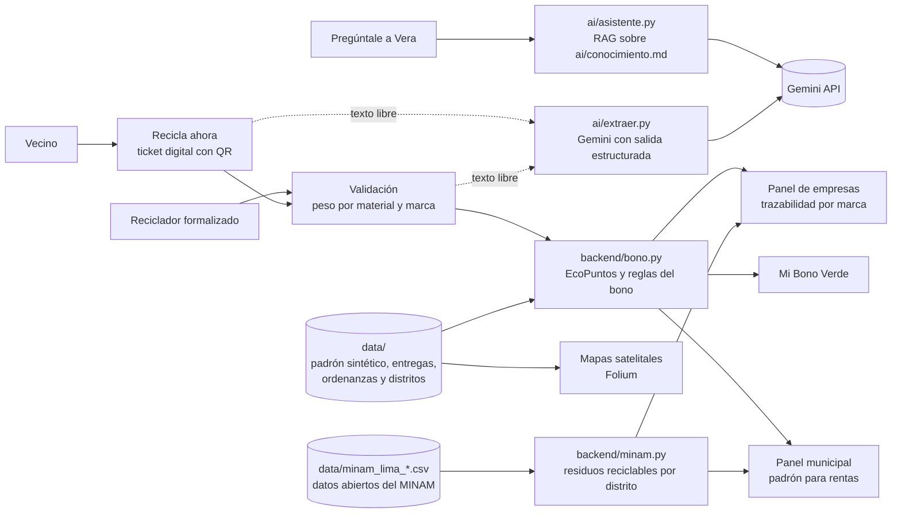

# Minka

*Juntos, cada aporte cuenta.*

> **Digitalizamos el Bono Verde municipal para que los vecinos que reciclan obtengan su descuento en arbitrios, las municipalidades lo administren sin papel y las empresas recuperen sus envases con trazabilidad por marca.**

| | |
|---|---|
| Demo pública | https://reciclagov-peru.streamlit.app/ |
| Video de respaldo | *(enlace pendiente)* |
| Founder | Ana Karen Zamalloa Lima |
| Curso | Proyecto final de la Diplomatura de Ciencia de Datos para las Ciencias Sociales y la Gestión Pública, Q-Lab PUCP, 2026 |

---

## 1. One-liner

Minka digitaliza el Bono Verde municipal para que los vecinos que separan sus residuos reciban su descuento en arbitrios, mediante un ticket digital que valida un reciclador formalizado y que alimenta, a su vez, el padrón municipal y la trazabilidad de envases que financian las empresas.

## 2. Founder


**Ana Karen Zamalloa Lima.** Comunicadora para el desarrollo y especialista en Gestión Pública por la PUCP, predocente del curso Medio Ambiente y Sostenibilidad, con experiencia en proyectos vinculados al medio ambiente, el desarrollo sostenible y la gestión pública.

Dirige el producto, el diseño y la relación con municipalidades y empresas, en tanto que Claude Code actúa como su socio técnico en la ingeniería del software.

## 3. Problema

### Quién lo sufre

El problema afecta a tres actores de manera simultánea. En primer lugar, a los **vecinos de los distritos de Lima que cuentan con un programa de segregación en la fuente**, quienes tienen derecho a un descuento en arbitrios que, en la práctica, desconocen o no pueden acreditar. En segundo lugar, a las **subgerencias de limpieza pública y de gestión ambiental de las municipalidades distritales**, que administran el incentivo con tickets físicos, padrones elaborados casa por casa y cruces manuales con el área de rentas. Finalmente, a las **empresas productoras de envases**, que deben demostrar la recuperación de material posconsumo y que, sin embargo, no cuentan con información verificable sobre el origen ni la marca de lo que se recicla.

### Cuánto les cuesta

El artículo 70 del Decreto Legislativo N.° 1278, modificado por el Decreto Legislativo N.° 1501, faculta a las municipalidades a otorgar incentivos a quienes segregan sus residuos. No obstante, el mecanismo funciona en papel. En Villa María del Triunfo, por ejemplo, el vecino debe reunir tickets físicos semanales entregados por el reciclador autorizado para acceder a un descuento de 20 % en el arbitrio de limpieza pública (Decreto de Alcaldía 010-2016-MVMT). Este procedimiento genera tres costos concretos. Por un lado, el vecino pierde el beneficio cuando extravía un ticket o cuando ignora que el programa existe. Por otro lado, la municipalidad destina horas de personal a consolidar padrones y a verificar entregas sin un registro estandarizado. Además, el Estado carece de información agregada, puesto que el Ministerio del Ambiente desconoce qué municipalidades aplican el incentivo y con qué resultados.

### Cómo se resuelve hoy

Actualmente, el incentivo se gestiona mediante tickets de papel, hojas de cálculo elaboradas por cada municipalidad y comunicaciones informales por WhatsApp entre recicladores y supervisores. Por su parte, las empresas recurren a acuerdos con acopiadores que reportan toneladas totales, sin distinguir la marca de los envases.

### Evidencia de tres conversaciones

Las notas completas se encuentran en [`docs/research/`](docs/research/).

| Conversación | Hallazgo principal |
|---|---|
| [Especialista en residuos sólidos del MINAM](docs/research/01_especialista_minam.md) | Cada municipalidad administra el Bono Verde según su propio criterio y no reporta al ministerio, de modo que el ente rector no sabe qué municipalidades lo aplican. |
| [Coordinadora de sostenibilidad de una empresa cervecera](docs/research/02_sostenibilidad_cervecera.md) | La empresa solo valora la recuperación de sus propios envases, por lo cual la trazabilidad por marca constituye la condición para que pague. |
| [Vecina de Villa María del Triunfo](docs/research/03_vecina_villa_maria.md) | Pese a que su distrito aprobó el incentivo en 2016, la vecina no sabe cómo funciona y en su hogar no se recicla. |

## 4. Solución e insight

### Qué construimos

Minka es una aplicación web que conecta a los cuatro actores del Bono Verde en un solo flujo.

1. **El vecino** registra los materiales que separó, ya sea marcándolos o describiéndolos con sus propias palabras, indica la marca de los envases y obtiene un ticket digital con código QR.
2. **El reciclador formalizado** busca el ticket, pesa cada material y valida la entrega, de modo que su trabajo queda registrado.
3. **El vecino** visualiza sus EcoPuntos, su avance hacia el descuento y la participación de su barrio.
4. **La municipalidad** descarga el padrón de beneficiarios listo para el área de rentas y compara el piloto con los residuos reales del distrito según el MINAM.
5. **La empresa** consulta cuántos kilos de sus propias marcas se recuperaron, en qué distritos de Lima conviene invertir según los datos del MINAM y descarga su certificado de trazabilidad.

Asimismo, la aplicación incluye un mapa que informa al vecino si su distrito premia el reciclaje, un asistente conversacional, Vera, que responde dudas sobre el Bono Verde, y una sección de registro en la que cada actor solicita su incorporación. El vecino se identifica con el código de contribuyente de su recibo de arbitrios, mientras que el reciclador lo hace con el carné que le otorga su municipalidad conforme a la Ley N.° 29419.

### Qué vemos que otros no ven

Las aplicaciones de reciclaje con puntos premian al vecino con descuentos comerciales, mientras que las municipalidades ya disponen de un incentivo legal más potente, el descuento en arbitrios, que no logran administrar. En consecuencia, el insight de Minka consiste en que **el mismo registro digital que el vecino necesita para acreditar su descuento es el dato que la municipalidad necesita para su padrón y el que la empresa necesita para demostrar la recuperación de sus envases**. Por ello, un único registro, validado por un reciclador formalizado, genera valor para el Estado y para el sector privado al mismo tiempo, y es la empresa, interesada en la trazabilidad por marca, la que financia el sistema.

La evidencia respalda este diseño. Por un lado, en dos experimentos realizados en China, el incentivo monetario resultó el más efectivo para promover el reciclaje, y conocer la conducta de los vecinos reforzó dicho efecto (Lu y Wang, 2022). Por otro lado, un sistema digital de incentivos implementado en Shanghái incrementó la recolección de reciclables en una comunidad piloto (Zhou et al., 2021).

## 5. Why now

Tres condiciones hacen posible esta solución hoy y no hace tres años.

1. **Marco normativo.** El Decreto Legislativo N.° 1501 de 2020 reforzó la facultad municipal de incentivar la segregación, mientras que la Ley N.° 30884 exige que las botellas de PET incorporen un porcentaje mínimo de material reciclado posconsumo, lo cual obliga a las empresas a asegurar abastecimiento verificable. A ello se suma la tendencia internacional hacia la responsabilidad extendida del productor, expresada en el nuevo reglamento europeo de envases (PPWR).
2. **Costo de la inteligencia artificial.** Los modelos de lenguaje con salidas estructuradas permiten convertir un mensaje informal del vecino, como "tres botellas de Inca Kola y un cartón", en un registro con material, cantidad y marca, a un costo de fracciones de céntimo por consulta.
3. **Adopción digital.** El uso del celular y de los códigos QR se generalizó en el Perú a partir de los pagos digitales, de modo que un ticket digital ya no representa una barrera para el vecino ni para el reciclador.

## 6. Demo

**URL pública.** https://reciclagov-peru.streamlit.app/

La demo emplea datos reales y datos sintéticos. Por un lado, son reales las ordenanzas municipales, los límites distritales de Lima, el catálogo de marcas y los datos abiertos del Ministerio del Ambiente sobre la generación y la composición de los residuos domiciliarios de los 51 distritos de Lima Metropolitana y el Callao entre 2019 y 2023. Por otro lado, el padrón de viviendas y el historial de entregas de Lurigancho-Chosica son sintéticos, con el fin de no utilizar datos personales de vecinos reales.

### Flujo principal en tres capturas

| 1. El vecino genera su ticket | 2. El reciclador valida | 3. El vecino recibe su Bono Verde |
|---|---|---|
|  |  |  |

### Arquitectura



### Modelos y servicios

| Componente | Herramienta | Razón de la elección |
|---|---|---|
| Lectura del mensaje del vecino | Gemini Flash (`gemini-flash-latest`) con un esquema de Pydantic | Devuelve material, cantidad y marca en un formato fijo, tiene un nivel gratuito suficiente para el piloto y un costo bajo a escala. Si la API no responde, un extractor de reglas propio garantiza que el flujo continúe. |
| Asistente Vera | Recuperación por palabras clave más generación con Gemini | Responde solo con la base de conocimiento del proyecto, lo cual reduce el riesgo de respuestas inventadas sobre normas o descuentos. |
| Mapas | Folium con imágenes satelitales de Esri y GeoJSON de distritos | Permite reconocer el propio barrio y ubicar los programas municipales vigentes. |
| Interfaz | Streamlit | Facilita un despliegue gratuito en Streamlit Community Cloud. |
| Transcripción de entrevistas | Whisper en la laptop de la autora | Las grabaciones contienen datos personales de terceros, por lo que no debían salir de la computadora local. |

### Cómo correrlo en local

```bash
git clone https://github.com/anakaren-zl/reciclagov.git
cd reciclagov
cp .env.example .env    # opcional, para activar Gemini con una clave propia
uv run --python 3.12 --with-requirements requirements.txt python -m streamlit run app/streamlit_app.py
```

La aplicación funciona aun sin clave de Gemini, dado que el extractor de reglas y la búsqueda en la base de conocimiento actúan como respaldo.

## 7. Modelo de negocio

### Quién paga

El modelo es mixto. La municipalidad adopta la herramienta sin costo, puesto que la barrera presupuestal y de contratación pública frenaría su adopción, mientras que **las empresas productoras de envases pagan por la trazabilidad de sus propias marcas**. Una parte de ese pago financia premios adicionales para los vecinos.

### Planes

| Plan | Cliente | Precio | Incluye |
|---|---|---|---|
| Municipal | Municipalidad distrital | S/ 0 | Ticket digital, validación por recicladores, tablero y padrón de beneficiarios para rentas |
| Trazabilidad | Empresa de envases | S/ 150 por tonelada de envases de sus marcas | Certificado mensual con fecha, sector y reciclador de cada entrega, sin datos personales |
| Territorio | Empresa de envases | S/ 2,500 al mes | Certificados ilimitados, ranking de sectores para decidir inversiones y reportes para metas de material reciclado |

Las tarifas constituyen supuestos de negocio que deberán validarse con las empresas durante el piloto.

### Costo por usuario

Para estimar el costo, se asume que cada vecino activo registra cuatro entregas al mes y realiza tres consultas a Vera.

| Concepto | Supuesto | Costo mensual por vecino |
|---|---|---|
| Tokens de Gemini | Cerca de 12,000 tokens de entrada y 2,500 de salida, con tarifas de referencia de USD 1.50 y USD 7.50 por millón | S/ 0.13 |
| Servidor y base de datos | Servidor de S/ 300 al mes para 10,000 vecinos | S/ 0.03 |
| **Total** | | **S/ 0.16** |

En los datos sintéticos, cada vivienda inscrita entrega cerca de 9 kg de reciclables al mes. Por consiguiente, mil vecinos generan alrededor de 9 toneladas mensuales, de modo que, si la mitad corresponde a marcas clientes, el plan de Trazabilidad produce cerca de S/ 675 frente a un costo de S/ 160, a lo que se suman los ingresos por suscripción del plan Territorio.

## 8. Herramientas del curso

| Herramienta | Sesión | Dónde está en el repo | Para qué la usa el cliente |
|---|---|---|---|
| LLM con salidas estructuradas | 08 | [`ai/extraer.py`](ai/extraer.py) | Convierte lo que el vecino o el reciclador escribe con sus palabras en una tabla de material, cantidad y marca. |
| RAG | 08 | [`ai/asistente.py`](ai/asistente.py), [`ai/conocimiento.md`](ai/conocimiento.md) | Vera responde dudas sobre el Bono Verde citando la sección de la base de conocimiento que utilizó. |
| Mapas con GeoPandas y Folium | 06 | [`app/mapas.py`](app/mapas.py), [`scripts/preparar_mapa.py`](scripts/preparar_mapa.py) | Muestra los programas municipales, la ubicación de las viviendas y los sectores que más reciclan. |
| Dashboards | 05 | [`app/streamlit_app.py`](app/streamlit_app.py), [`app/componentes.py`](app/componentes.py) | Tableros para la municipalidad y para las empresas. |
| Datos abiertos | 03 | [`backend/minam.py`](backend/minam.py), [`scripts/preparar_minam.py`](scripts/preparar_minam.py) | Muestra cuántas toneladas de residuos reciclables genera cada distrito y en cuáles conviene que una empresa invierta, con datos reales del MINAM. |
| Despliegue de productos de datos | 12 | [`.streamlit/`](.streamlit/), [`requirements.txt`](requirements.txt) | Publicación en Streamlit Community Cloud con la clave guardada en los secretos de la plataforma. |
| Whisper | 13 | Uso local, fuera del repo | Transcripción de la entrevista al especialista del MINAM, sin subir el audio a internet. |

Se eligieron estas herramientas debido a que responden a los dos cuellos de botella del problema. Por un lado, las salidas estructuradas reducen la fricción del registro, ya que el vecino no necesita llenar formularios. Por otro lado, los mapas y tableros convierten cada registro en información útil para la municipalidad y para la empresa.

## 9. Qué hizo el agente

El proyecto se desarrolló con Claude, en su versión de chat y en Claude Code, como socio técnico. Las instrucciones de trabajo del agente se encuentran en [`CLAUDE.md`](CLAUDE.md).

**El agente generó o ayudó a escribir** el código de la aplicación (`app/`), los módulos de inteligencia artificial (`ai/`), la lógica del bono y del catálogo de marcas (`backend/`), los scripts que generan los datos sintéticos y preparan el mapa (`scripts/`), los estilos visuales y animaciones, la búsqueda de ordenanzas municipales y de literatura, así como la estructura de las notas de investigación y de este README.

**La founder se encargó** de la definición del problema y del modelo de negocio, del nombre y la identidad de Minka, de la misión, la visión y los valores, de las tres conversaciones con usuarios, de la validación de cada decisión de producto a partir de esas conversaciones, de la descarga de los datos abiertos del MINAM, de la paleta de colores, de los personajes Vera y Don Ciclo, del video de portada, de la revisión de la experiencia de usuario y de la redacción, así como de las pruebas de la aplicación. El retrato de Vera que acompaña su historia en la página de inicio fue generado con inteligencia artificial y así se indica en la aplicación.

---

## Competencia

| Alternativa | Qué ofrece | Qué le falta |
|---|---|---|
| No hacer nada | El incentivo existe en la norma | Los vecinos no lo conocen y el Estado no tiene datos |
| Papel y Excel | Tickets físicos y padrones municipales | Pérdida de tickets, horas de personal y ausencia de trazabilidad por marca |
| TuPoinT | Puntos por reciclar canjeables en comercios | No se vincula con el descuento en arbitrios ni con el padrón municipal |
| RECICLOS (España) | Recompensas por reciclar latas y botellas con escaneo de código de barras | No opera en el Perú ni con incentivos tributarios municipales |

## Limitaciones

En primer lugar, el padrón y las entregas son sintéticos, por lo que los indicadores del piloto no describen la situación real de Lurigancho-Chosica, a diferencia de las cifras de residuos por distrito, que provienen del MINAM. En segundo lugar, las tarifas del modelo de negocio aún no han sido validadas con empresas. Asimismo, la conversación con la vecina de Villa María del Triunfo advierte que, en distritos donde el recojo municipal falla, un incentivo al reciclaje difícilmente funcionará por sí solo, razón por la cual el piloto se plantea en un distrito con un programa de segregación vigente. Finalmente, la identificación de la marca depende de lo que declara el vecino y verifica el reciclador, de modo que una versión futura podría incorporar el escaneo de códigos de barras.

## Referencias

- Decreto Legislativo N.° 1278, Ley de Gestión Integral de Residuos Sólidos, artículo 70, modificado por el Decreto Legislativo N.° 1501.
- Ley N.° 30884, Ley que regula el plástico de un solo uso y los recipientes o envases descartables.
- Lu, B. y Wang, J. (2022). How can residents be motivated to participate in waste recycling? An analysis based on two survey experiments in China. *Waste Management*, 143, 206–214.
- Zhou, J., Jiang, P., Yang, J. y Liu, X. (2021). Designing a smart incentive-based recycling system for household recyclable waste. *Waste Management*, 123, 142–153.
- Ministerio del Ambiente (2024). Composición de residuos sólidos domiciliarios y Generación anual de residuos sólidos domiciliarios y municipales. Plataforma Nacional de Datos Abiertos, corte del 12 de diciembre de 2024.
- Ordenanzas municipales listadas en [`data/municipalidades_bono.csv`](data/municipalidades_bono.csv).

## Licencia

Este proyecto se distribuye bajo la licencia MIT. Véase el archivo [`LICENSE`](LICENSE).
