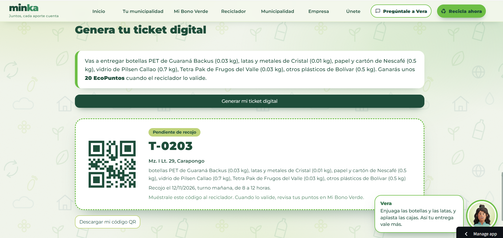
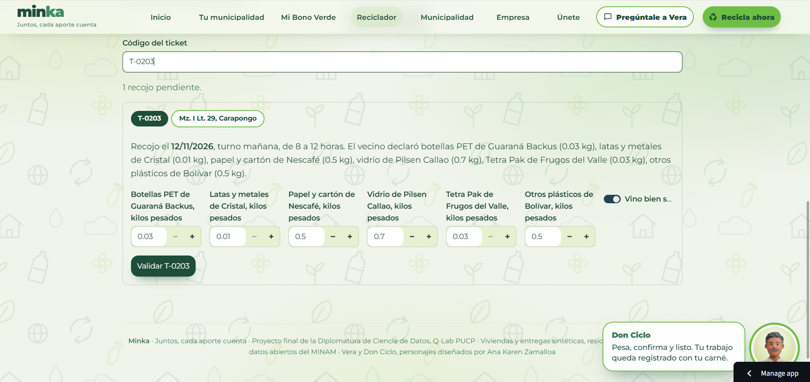
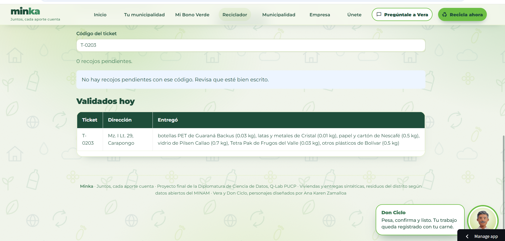
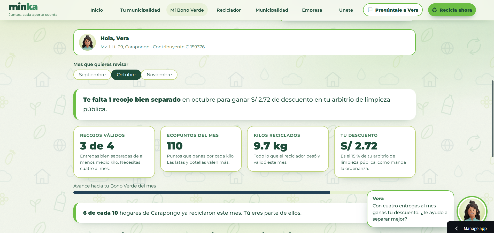
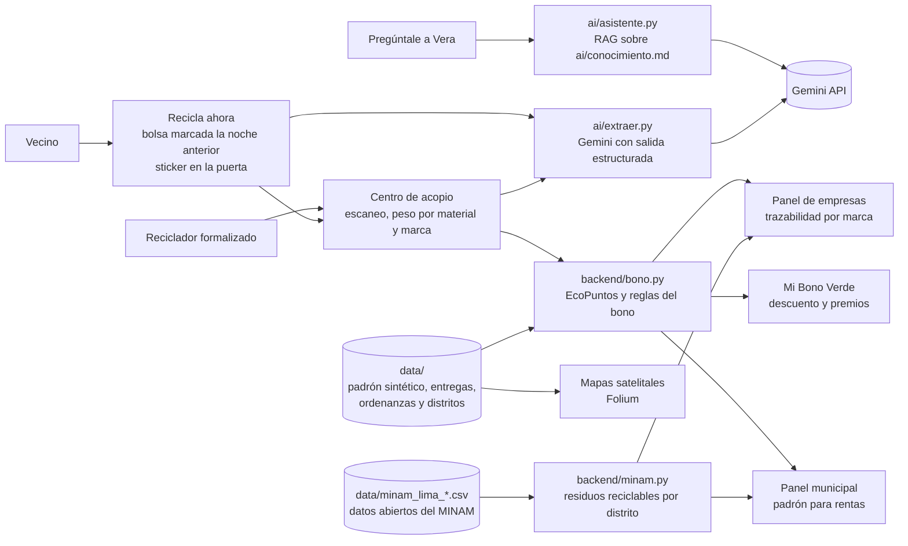

# Minka

*Juntos, cada aporte cuenta.*

> **Minka digitaliza el Bono Verde de las municipalidades de Lima para que los vecinos que separan sus residuos obtengan su descuento en arbitrios, las municipalidades lo administren sin papel y las empresas recuperen sus envases con trazabilidad por marca.**

| | |
|---|---|
| Demo pública | https://minka-peru.streamlit.app/ |
| Video de respaldo | *(enlace pendiente)* |
| Founder | Ana Karen Zamalloa Lima |
| Curso | Proyecto final de la Diplomatura de Especialización en Ciencia de Datos para las Ciencias Sociales y la Gestión Pública, Q-Lab PUCP, 2026 |

---

## 1. One-liner

Minka digitaliza el Bono Verde para que los vecinos de los distritos de Lima con programas municipales de segregación en la fuente, obtengan su descuento en arbitrios mediante un ticket digital que valida un reciclador formalizado y que, a su vez, alimenta el padrón municipal y la trazabilidad de envases que financian las empresas.

El nombre proviene de la *minka*, tradición andina de trabajo colectivo en beneficio de la comunidad, puesto que el reciclaje solo funciona cuando vecinos, recicladores, municipalidades y empresas actúan de manera conjunta.

## 2. Founder


**Ana Karen Zamalloa Lima.** Comunicadora para el desarrollo y especialista en Gestión Pública por la PUCP, predocente del curso Medio Ambiente y Sostenibilidad, con experiencia en proyectos vinculados al medio ambiente, el desarrollo sostenible y la gestión pública.

*Dirige el producto, el diseño y la relación con municipalidades y empresas, en tanto que Claude Code actúa como su socio técnico en la ingeniería del software.*

## 3. Problema

### 3.1 Relevancia ambiental del reciclaje domiciliario

La generación de residuos sólidos constituye uno de los desafíos ambientales más persistentes de las ciudades. Según el Banco Mundial, el planeta generó 2,010 millones de toneladas de residuos sólidos municipales en 2016 y, de mantenerse las tendencias actuales, dicha cifra alcanzaría los 3,400 millones de toneladas hacia 2050, con un crecimiento especialmente acelerado en los países de ingresos medios (Kaza et al., 2018). En el caso particular de los envases plásticos, cerca de un tercio escapa de los sistemas de recolección y termina en el ambiente (Ellen MacArthur Foundation, 2016). En consecuencia, la separación en la fuente y el reciclaje no solo reducen la presión sobre los rellenos sanitarios, sino que también devuelven materiales a la economía y disminuyen la extracción de recursos vírgenes.

El Perú refleja este desafío con particular intensidad. En 2016 se generaron más de siete millones de toneladas de residuos sólidos municipales urbanos y, sin embargo, solo se recicló el 1.9 % de los residuos reaprovechables (Ministerio del Ambiente [MINAM], s. f.). Asimismo, la Defensoría del Pueblo (2019) advierte que alrededor del 70 % de los residuos municipales proviene de los domicilios, de modo que el hogar constituye el punto de partida de cualquier política de reciclaje. Los datos abiertos del MINAM confirman esta oportunidad a escala distrital, puesto que en 2023 los hogares de Lurigancho-Chosica generaron 60,193 toneladas de residuos, de las cuales cerca de 24 de cada 100 correspondían a materiales reciclables como papel, cartón, plásticos, vidrio y metales (MINAM, 2024a).

### 3.2 ¿Quién lo sufre?

El problema afecta a cuatro actores de manera simultánea. En primer lugar, a los **vecinos de los distritos de Lima que cuentan con un programa municipal de segregación en la fuente**, como Lurigancho-Chosica, Villa El Salvador, Villa María del Triunfo o San Juan de Lurigancho, quienes tienen derecho a un descuento en arbitrios que, en la práctica, desconocen o no pueden acreditar. En segundo lugar, a las **subgerencias de limpieza pública y de gestión ambiental de las municipalidades distritales**, que administran el incentivo con tickets físicos, padrones elaborados casa por casa y cruces manuales con el área de rentas. En tercer lugar, a las **empresas productoras de envases**, que deben demostrar la recuperación de material posconsumo y que, no obstante, carecen de información verificable sobre el origen y la marca de lo que se recicla. Finalmente, a los **recicladores formalizados**, cuya labor sostiene buena parte de la recuperación de materiales en las ciudades latinoamericanas, aunque con frecuencia permanece invisible y mal remunerada (Dias, 2016; Medina, 2007).

### 3.3 ¿Cuánto les cuesta?

El artículo 70 del Decreto Legislativo N.° 1278, modificado por el Decreto Legislativo N.° 1501, faculta a las municipalidades a otorgar incentivos a quienes segregan sus residuos (Presidencia de la República del Perú, 2016, 2020). No obstante, el mecanismo funciona en papel. En Villa María del Triunfo, por ejemplo, el vecino debe reunir tickets físicos entregados por el reciclador autorizado para acceder a un descuento de 20 % en el arbitrio de limpieza pública (Municipalidad Distrital de Villa María del Triunfo, 2016). Este procedimiento genera costos concretos para cada actor.

| Actor | Costo |
|---|---|
| Vecino | Pierde el descuento cuando extravía un ticket o cuando ignora que el programa existe. En el piloto, ese descuento equivale a cerca de S/ 33 al año por hogar, calculado con tasas de arbitrio sintéticas. |
| Municipalidad | Destina horas de personal a consolidar padrones y verificar entregas sin un registro estandarizado. Además, sigue pagando el transporte y la disposición final de residuos reciclables, que en Lurigancho-Chosica suman 14,639 toneladas al año (MINAM, 2024a). |
| Empresa | No puede demostrar con evidencia verificable cuántos envases de sus marcas se recuperan, lo cual dificulta el cumplimiento de la Ley N.° 30884 y de sus metas de sostenibilidad. |
| Estado | Carece de información agregada, puesto que el ente rector desconoce qué municipalidades aplican el incentivo y con qué resultados. |

### 3.4 ¿Cómo se resuelve hoy?

Actualmente, el incentivo se gestiona mediante tickets de papel, hojas de cálculo elaboradas por cada municipalidad y comunicaciones informales por WhatsApp entre recicladores y supervisores. Por su parte, las empresas recurren a acuerdos con acopiadores que reportan toneladas totales, sin distinguir la marca de los envases.

### 3.5 Evidencia de cinco conversaciones

#### Método

La validación del problema se basó en cinco conversaciones semiestructuradas con usuarios potenciales, realizadas el 10 y el 11 de noviembre de 2026 por llamada telefónica, mensajes de WhatsApp y mensaje de voz. La selección de los participantes siguió un muestreo intencional, orientado a obtener casos ricos en información sobre el fenómeno de estudio (Patton, 2015), de modo que las conversaciones representaran a los actores del Bono Verde, es decir, al Estado en sus niveles nacional y local, a la empresa y a la ciudadanía. Las tres primeras orientaron el diseño inicial, mientras que las dos últimas se realizaron después de publicar la aplicación y condujeron a rediseñar la logística del recojo y el esquema de incentivos. Asimismo, las preguntas se centraron en experiencias pasadas y conductas concretas, y no en opiniones sobre la solución, con el fin de evitar respuestas complacientes (Fitzpatrick, 2013). Las notas completas se encuentran en [`docs/research/`](docs/research/), mientras que las grabaciones y transcripciones permanecen fuera del repositorio por contener datos personales de terceros.

#### El Estado. Gustavo Miranda, especialista en residuos sólidos del MINAM

Notas completas en [`01_especialista_minam.md`](docs/research/01_especialista_minam.md).

Gustavo Miranda, especialista en residuos sólidos del Ministerio del Ambiente, quien autorizó la mención de su nombre, confirmó que cada municipalidad administra el Bono Verde según su propio criterio y dentro de su competencia, que las municipalidades no reportan al ministerio cuántos vecinos participan y que, en consecuencia, el ente rector no sabe qué municipalidades aplican el incentivo. Del mismo modo, precisó que el MINAM se concentra en la dimensión normativa y en la capacitación de los gobiernos locales (G. Miranda, comunicación personal, 10 de noviembre de 2026).

Este hallazgo ilustra lo que la literatura sobre políticas públicas denomina la brecha de implementación, es decir, la distancia entre lo que una norma autoriza y lo que efectivamente ocurre cuando su ejecución depende de múltiples actores y niveles de gobierno (Pressman y Wildavsky, 1973). En el caso del Bono Verde, la descentralización de la gestión de residuos otorga autonomía a cada municipalidad, aunque sin un sistema de información común que permita al Estado conocer los resultados. Por ello, Minka genera registros estandarizados y agregados que pueden servir tanto a la municipalidad como al ente rector.

#### El gobierno local. Asistente ambiental de la Municipalidad Distrital de Lince

Notas completas en [`05_municipalidad_lince.md`](docs/research/05_municipalidad_lince.md).

La asistente ambiental de la Municipalidad Distrital de Lince, quien autorizó la mención de su cargo, relató su experiencia previa en la Municipalidad Distrital de Villa El Salvador, donde trabajó en 2023. Según su relato, allí el Bono Verde surgió como una respuesta a los vecinos que, durante el empadronamiento, preguntaban qué recibirían a cambio de entregar su material. No obstante, ese año el descuento ofrecido no llegó a aplicarse, posiblemente porque su presupuesto no fue aprobado, de modo que muchos vecinos dejaron de participar porque se sintieron engañados, razón por la cual se buscó motivarlos con la entrega de plantas cada dos meses. En cambio, en Lince el programa no ofrece descuentos y la participación se sostiene con la bolsa que el reciclador devuelve en cada recojo y, en el caso de los edificios participantes, con el recojo directo de muebles sin trámite por mesa de partes. Asimismo, precisó que el artículo 34 del Decreto Legislativo N.° 1278 obliga al generador a entregar su material aprovechable al programa municipal o a una empresa autorizada, aunque Lince aún no cuenta con una ordenanza que haga exigible esa obligación para los hogares (asistente ambiental de la Municipalidad Distrital de Lince, comunicación personal, 11 de noviembre de 2026).

Este testimonio ilustra lo que la economía del comportamiento denomina el desplazamiento de la motivación, según el cual un incentivo externo mal diseñado puede debilitar la disposición previa de las personas a colaborar (Frey y Oberholzer-Gee, 1997). En la misma línea, Gneezy et al. (2011) advierten que los incentivos transmiten señales sobre quien los otorga, de modo que un incentivo incumplido comunica que la institución no es confiable. En consecuencia, Minka no puede limitarse a digitalizar una promesa, sino que debe garantizar que solo se ofrezcan beneficios financiados y que cada recojo validado quede registrado como constancia verificable del derecho del vecino.

#### La empresa. Coordinadora de sostenibilidad de Backus

Notas completas en [`02_sostenibilidad_backus.md`](docs/research/02_sostenibilidad_backus.md).

La coordinadora de sostenibilidad de Backus, quien autorizó la mención de la empresa y de su cargo, señaló que a la compañía le interesa que retorne lo que salió al mercado, razón por la cual el material de otras marcas no contribuye a sus indicadores. Asimismo, indicó que la lata es el envase prioritario, que la trazabilidad por marca constituye la principal condición para invertir y que una decisión de inversión requiere información sobre los distritos y las zonas con mayor reciclaje (coordinadora de sostenibilidad de Backus, comunicación personal, 10 de noviembre de 2026).

Este testimonio es coherente con el principio de responsabilidad extendida del productor, según el cual el fabricante asume la responsabilidad por el ciclo de vida completo de sus productos, incluida su etapa posconsumo (Lindhqvist, 2000). La Organización para la Cooperación y el Desarrollo Económicos sostiene que estos sistemas requieren mecanismos confiables de monitoreo y verificación para evitar que los productores financien recuperaciones que no pueden atribuirse a sus envases (Organisation for Economic Co-operation and Development [OECD], 2016). En consecuencia, la conversación invalidó el supuesto inicial de que las empresas pagarían por kilos de material en general y condujo a incorporar la marca en cada registro.

#### La empresa. Analista de comunicaciones de Tetra Pak

Notas completas en [`04_tetra_pak.md`](docs/research/04_tetra_pak.md).

La analista de comunicaciones de la oficina central para América Latina de Tetra Pak, quien autorizó la mención de la empresa y de su cargo, valoró que Minka se apoye en el gobierno local y señaló que la trazabilidad sería útil para su empresa. Sin embargo, advirtió que la brecha digital de los recicladores es muy alta, por lo que exigirles escanear un código QR en cada vivienda resulta poco realista, y que la logística de coordinar horarios, trasladar y pesar el material es compleja. Del mismo modo, sostuvo que ni los recicladores ni los vecinos cambiarán su rutina si no perciben un retorno real, el cual debería provenir principalmente de la municipalidad y podría complementarse mediante una alianza con las empresas (analista de comunicaciones de Tetra Pak, comunicación personal, 10 y 11 de noviembre de 2026).

Esta observación es coherente con el enfoque de mercadeo social comunitario, según el cual una conducta sostenible solo se adopta cuando se eliminan sus barreras prácticas y se refuerzan sus beneficios percibidos, puesto que la información por sí sola rara vez modifica la conducta (McKenzie-Mohr, 2011). Por ello, la conversación condujo a tres cambios de diseño. En primer lugar, el recojo se organiza por rutas fijas, de modo que el vecino saca su bolsa la noche anterior. En segundo lugar, cada vivienda cuenta con un sticker QR fijo y la validación se realiza en el centro de acopio, con un solo celular por asociación. Finalmente, cada actor recibe un beneficio concreto, como se detalla en el apartado 4.5.

#### La ciudadanía. Vecina de Villa María del Triunfo

Notas completas en [`03_vecina_villa_maria.md`](docs/research/03_vecina_villa_maria.md).

La vecina recordó vagamente que en su distrito existió un descuento por reciclaje, pero afirmó que en su casa no reciclan porque no saben cómo funciona el programa. Además, señaló que la municipalidad no promueve el reciclaje y que el distrito enfrenta problemas recurrentes con el recojo de basura (vecina de Villa María del Triunfo, comunicación personal, 10 de noviembre de 2026).

Este hallazgo coincide con la teoría del comportamiento planificado, que identifica al control conductual percibido, es decir, la percepción de cuán fácil o difícil resulta realizar una conducta, como uno de los determinantes de la intención de actuar (Ajzen, 1991). De manera complementaria, Kollmuss y Agyeman (2002) explican que la distancia entre la conciencia ambiental y la acción proambiental se amplía cuando faltan información, infraestructura e incentivos. Por ello, Minka incorpora instrucciones paso a paso, un mapa que informa si el distrito premia el reciclaje y un asistente conversacional que responde dudas en lenguaje sencillo.

#### Síntesis

La triangulación de las cinco fuentes, recurso que permite contrastar perspectivas distintas sobre un mismo fenómeno (Patton, 2015), revela un mismo vacío desde distintos ángulos.

| Actor | ¿Qué necesita? | ¿Qué falta hoy? | Respuesta de Minka |
|---|---|---|---|
| Estado nacional | Saber quién aplica el incentivo y con qué resultados | Un sistema de información común | Registros estandarizados y agregados por distrito |
| Gobierno local | Motivar a los vecinos sin prometer lo que no puede cumplir | Beneficios financiados y una constancia de cada recojo | Solo beneficios aprobados, beneficios de servicio y registro verificable |
| Empresa | Demostrar la recuperación de sus propios envases | Trazabilidad por marca | Registro de material, marca, sector y reciclador en cada entrega |
| Reciclador | Un retorno real que no dependa de tener un celular inteligente | Pago por el servicio y una logística simple | Rutas fijas, validación en el centro de acopio y bono por kilo |
| Ciudadanía | Saber cómo participar y ver que su esfuerzo cuenta | Información, comodidad y confianza | Bolsa la noche anterior, sticker QR, avance del bono y meta del barrio |

En síntesis, el incentivo existe en la norma, aunque no llega al vecino, a veces se promete sin financiamiento, no genera datos para el Estado y no ofrece a las empresas la trazabilidad que necesitan para financiarlo.

## 4. Solución e insight

### 4.1 ¿Qué construimos?

Minka es una aplicación web que conecta a los cuatro actores del Bono Verde en un solo flujo.

1. **El vecino** registra los materiales que separó, ya sea marcándolos o describiéndolos con sus propias palabras, e indica la marca de los envases. Luego saca su bolsa la noche anterior al día de ruta de su sector, de modo que no necesita esperar al reciclador. Cada vivienda participante cuenta con un sticker en la puerta, con la frase «Esta casa recicla con Minka» y el código QR de la vivienda, mientras que las bolsas de reposición que entrega el reciclador ya vienen marcadas con ese mismo código.
2. **El reciclador formalizado** recoge las bolsas durante su recorrido de madrugada y las lleva al centro de acopio, donde el encargado de pesaje de la asociación escanea el código de cada bolsa, pesa cada material y valida la entrega con un solo celular. Así, el reciclador no necesita un celular inteligente y su trabajo queda registrado a su nombre.
3. **El vecino** visualiza en la sección Mi Bono Verde lo que puede ganar, es decir, su descuento mensual en arbitrios y los premios que puede canjear con sus EcoPuntos, así como la participación de su barrio.
4. **La municipalidad** descarga el padrón de beneficiarios listo para el área de rentas y compara el piloto con los residuos reales del distrito según el MINAM.
5. **La empresa** consulta cuántos kilos de sus propias marcas se recuperaron, en qué distritos de Lima conviene invertir según los datos del MINAM y descarga su certificado de trazabilidad.

Asimismo, la aplicación incluye un mapa que informa al vecino si su distrito premia el reciclaje, un asistente conversacional, Vera, que responde dudas sobre el Bono Verde, y una sección de registro en la que cada actor elige su plan y solicita su incorporación. El vecino se identifica con el código de contribuyente de su recibo de arbitrios, mientras que el reciclador lo hace con el carné que le otorga su municipalidad conforme a la Ley N.° 29419 (Congreso de la República del Perú, 2009b).

### 4.2 Fundamentos teóricos

El diseño de Minka se sustenta en tres líneas de la literatura sobre el comportamiento de reciclaje.

**Incentivos económicos.** La economía ambiental sostiene que el reciclaje domiciliario genera beneficios sociales que el hogar no internaliza por sí mismo, lo cual justifica la intervención pública mediante incentivos (Kinnaman, 2006). En esa línea, Lu y Wang (2022) compararon cuatro tipos de incentivos en dos experimentos con residentes chinos y encontraron que el incentivo monetario fue el más efectivo para motivar la participación en el reciclaje, por encima de los incentivos de encuadre ambiental, institucionales y morales. El descuento en arbitrios constituye, precisamente, un incentivo monetario respaldado por la norma peruana.

**Normas sociales y retroalimentación.** Schultz (1999) demostró en un experimento de campo que informar a los hogares sobre su propio desempeño y el de su vecindario incrementa la participación en el reciclaje. De manera consistente, la revisión sistemática con metaanálisis de Varotto y Spagnolli (2017) identificó a la retroalimentación y a las normas sociales entre las estrategias psicológicas con efectos positivos en intervenciones de campo, mientras que Lu y Wang (2022) hallaron que las normas descriptivas moderan positivamente el efecto de los incentivos. Por ello, Minka muestra al vecino cuántos hogares de su sector ya reciclan y cómo se compara con el promedio de su barrio.

**Digitalización e inclusión de los recicladores.** Zhou et al. (2021) evaluaron un sistema digital de incentivos para residuos reciclables domiciliarios en Shanghái y reportaron un incremento de 229.3 % en la cantidad recolectada en una comunidad piloto. Por otra parte, la literatura sobre recicladores de base subraya que su integración formal en los sistemas municipales mejora tanto la recuperación de materiales como sus condiciones de trabajo (Dias, 2016; Medina, 2007). En consecuencia, Minka asigna al reciclador formalizado el rol de validar cada entrega, de modo que su labor queda registrada y reconocida.

### 4.3 Antecedentes y benchmarking

La revisión de experiencias internacionales y nacionales muestra que los incentivos al reciclaje y la responsabilidad del productor avanzan en distintas regiones, aunque ninguna de ellas articula el incentivo tributario municipal con la trazabilidad por marca.

| Experiencia | ¿Qué hace? | Lección para Minka |
|---|---|---|
| Unión Europea | El Reglamento (UE) 2025/40 obliga a los Estados miembros a contar con sistemas de depósito y devolución para botellas plásticas y latas de bebidas y a recolectar al menos el 90 % de estos envases a partir de 2029 (Parlamento Europeo y Consejo de la Unión Europea, 2025). | La trazabilidad de los envases y la responsabilidad del productor se convierten en obligaciones regulatorias. |
| España | RECICLOS, desarrollado por Ecoembes, es un sistema de devolución y recompensa en el que el ciudadano escanea sus latas y botellas con una aplicación web y códigos QR y recibe puntos canjeables por recompensas sociales y ambientales (Ecoembes, 2021). | Las recompensas digitales y la alianza con los municipios son viables a gran escala. |
| Chile | La Ley N.° 20.920 establece la responsabilidad extendida del productor, con metas de recolección y valorización para envases y embalajes (Congreso Nacional de Chile, 2016). | Las empresas financian la recolección cuando la norma les asigna metas verificables. |
| Colombia | La Resolución 1407 de 2018 obliga a los productores a formular planes de gestión ambiental de residuos de envases y empaques con metas de aprovechamiento (Ministerio de Ambiente y Desarrollo Sostenible, 2018). | Los productores requieren evidencia del aprovechamiento de sus envases. |
| Perú, sector público | Villa El Salvador aplica el Bono Verde desde 2004, San Juan de Lurigancho creó el Ecobono en 2016 y Lurigancho-Chosica aprobó en 2024 un descuento de 15 % para los participantes de su Programa Recicla (El Popular, 2016; Municipalidad Distrital de Lurigancho, 2024; Municipalidad Distrital de Villa El Salvador, s. f.). | El incentivo tributario existe, pero se administra en papel y sin datos agregados, y su financiamiento no siempre está asegurado, como muestra el descuento ofrecido y no aplicado en Villa El Salvador en 2023, según la conversación 5. |
| Perú, sector privado | TuPoinT, creada en 2022, otorga puntos por cada botella reciclada que pueden canjearse por descuentos en negocios afiliados (Infomercado, s. f.). | Existe disposición ciudadana a reciclar a cambio de beneficios, aunque sin vínculo con la municipalidad. |

### 4.4 Valor agregado

Las aplicaciones de reciclaje con puntos premian al vecino con descuentos comerciales, mientras que las municipalidades ya disponen de un incentivo legal más potente, el descuento en arbitrios, que no logran administrar. En consecuencia, el insight de Minka consiste en que **el mismo registro digital que el vecino necesita para acreditar su descuento es el dato que la municipalidad necesita para su padrón y el que la empresa necesita para demostrar la recuperación de sus envases**. A partir de esta idea, el valor agregado se expresa de manera distinta para cada actor.

**Para el vecino.** Minka digitaliza el descuento en arbitrios que la ley ya permite, en lugar de crear un premio paralelo, y lo complementa con premios financiados por las empresas. Además, le muestra su avance y el de su barrio, de modo que su esfuerzo deja de ser invisible.

**Para el reciclador formalizado.** El reciclador se convierte en el validador del sistema, por lo que cada kilo que pesa queda registrado a su nombre. Este registro le permite demostrar su productividad ante la municipalidad y las empresas, y respalda un trato más justo, en coherencia con la Ley N.° 29419 y con la literatura sobre inclusión de recicladores (Dias, 2016).

**Para la municipalidad.** Obtiene sin costo el padrón de beneficiarios listo para el área de rentas, reduce el trabajo manual y dispone de datos para reportar sus metas ambientales.

**Para la empresa, que es el cliente.** ¿Por qué una empresa contrataría a Minka? Por cuatro razones.

1. **Cumplimiento normativo.** La Ley N.° 30884 exige que las botellas de PET incorporen material reciclado posconsumo, mientras que el principio de responsabilidad extendida del productor gana terreno en la región, como muestran las normas de Chile y Colombia (Congreso de la República del Perú, 2018; OECD, 2016). Minka le ofrece evidencia verificable de la recuperación de sus propios envases.
2. **Reportes de sostenibilidad creíbles.** El estándar GRI 306 pide a las organizaciones informar sobre los residuos vinculados con sus actividades y productos, así como sobre su destino (Global Reporting Initiative [GRI], 2020). El certificado de Minka detalla material, marca, sector, fecha y reciclador, sin datos personales.
3. **Inversión mejor dirigida.** Con los datos abiertos del MINAM, la empresa identifica los distritos de Lima que generan más toneladas de sus materiales y, con los registros del piloto, los sectores donde una campaña rinde más por cada sol invertido.
4. **Abastecimiento y reputación.** Un flujo trazable de envases posconsumo contribuye al abastecimiento de material reciclado y vincula la marca con un beneficio visible para los vecinos y los recicladores.

**¿Por qué una empresa querría aliarse con el sector público?** A primera vista, la gestión de residuos parece un asunto exclusivamente estatal, puesto que la ley asigna a las municipalidades la recolección y la disposición final. Sin embargo, los envases que llegan a los hogares son puestos en el mercado por las empresas, de modo que, sin una alianza, la municipalidad termina financiando con recursos públicos la gestión de residuos que generan productos privados. El principio de responsabilidad extendida del productor corrige precisamente esa asimetría (Lindhqvist, 2000; OECD, 2016). Más allá de recuperar sus envases, la empresa obtiene cinco beneficios de aliarse con las municipalidades a través de Minka.

1. **Acceso al territorio y a escala.** La municipalidad ya cuenta con programas de segregación, padrones de vecinos y recicladores formalizados registrados. Para la empresa, construir por su cuenta una red de recolección casa por casa resultaría más costoso y lento que sumarse a la infraestructura pública existente. La literatura sobre colaboración intersectorial sostiene que estas alianzas surgen cuando ningún sector puede resolver por sí solo un problema público complejo (Bryson et al., 2006).
2. **Legitimidad y licencia social.** Las organizaciones buscan que sus acciones sean percibidas como deseables y apropiadas por la sociedad, y esa legitimidad resulta más sólida cuando es reconocida por actores públicos (Suchman, 1995). Una campaña respaldada por la municipalidad y validada por recicladores formalizados es más creíble que una iniciativa unilateral de la marca, lo cual reduce el riesgo de ser percibida como un mero ejercicio de imagen.
3. **Valor compartido.** Según Porter y Kramer (2011), las empresas pueden generar valor económico al mismo tiempo que resuelven problemas sociales. En este caso, el mismo flujo que recupera los envases de la empresa reduce el costo de la limpieza pública, mejora el ingreso de los recicladores y premia al vecino.
4. **Relación directa con el consumidor.** Los premios que financia la empresa llegan al vecino como un reconocimiento de su marca por reciclar sus envases, lo cual crea un vínculo positivo con el consumidor en su propio barrio, siempre a partir de datos agregados y sin información personal.
5. **Anticipación regulatoria y participación en la gobernanza.** La gobernanza colaborativa permite que los actores privados participen en la definición de soluciones públicas junto con el Estado (Ansell y Gash, 2008). En el Perú, el MINAM ya promueve Acuerdos de Producción Limpia en los que las empresas se comprometen a articular programas de segregación con los gobiernos locales (Revista Economía, s. f.). Por ello, la empresa que participa hoy en un sistema trazable llega mejor preparada a una eventual regulación de responsabilidad extendida para envases, como las que ya rigen en Chile y Colombia.

En síntesis, la alianza no traslada a la empresa una responsabilidad ajena, sino que le permite asumir de manera eficiente y visible la parte que le corresponde en la gestión de los residuos que sus productos generan.

**¿Por qué pagan las empresas y no las municipalidades?** Minka funciona como una plataforma de dos lados, en la que el valor para un grupo de usuarios depende de la participación del otro. En este tipo de mercados, la literatura muestra que conviene subsidiar al lado cuya adhesión es más difícil y cobrar al lado que obtiene mayor beneficio de la red (Rochet y Tirole, 2003). Las municipalidades enfrentan restricciones presupuestales y procesos de contratación lentos y, además, ya asumen el costo fiscal del descuento en arbitrios, de modo que cobrarles frenaría la adopción. Por el contrario, cada municipalidad que se suma aporta vecinos y recicladores que generan los registros por los que pagan las empresas. En consecuencia, el plan municipal gratuito no constituye una pérdida, sino la estrategia que construye la red de datos que la empresa valora, en coherencia con el principio según el cual quien pone el envase en el mercado financia su recuperación (OECD, 2016).

### 4.5 ¿Por qué participaría cada actor? Estrategia de incentivos y comunicación

Una aplicación no cambia hábitos por sí sola. Cualquier vecino puede responder que no quiere sacar su basura ni reciclar, y cualquier reciclador puede preguntar qué gana registrando su trabajo. Por ello, este apartado responde, para cada actor, por qué participaría en Minka y qué beneficio concreto recibiría.

El diseño se apoya en dos marcos complementarios. Por un lado, el mercadeo social comunitario propone seleccionar una conducta específica, identificar las barreras y los beneficios que las personas perciben en ella y aplicar herramientas cuya eficacia está documentada, como el compromiso, los recordatorios, las normas sociales, los incentivos y la comodidad (McKenzie-Mohr, 2011). Por otro lado, el marco EAST resume la evidencia de las ciencias del comportamiento en cuatro principios, según los cuales una conducta se adopta con mayor probabilidad cuando resulta fácil, atractiva, social y oportuna (Service et al., 2014). A ello se suma la principal lección de la conversación con la Municipalidad de Lince, es decir, que un incentivo prometido y no cumplido resulta más dañino que la ausencia de incentivo, puesto que debilita la motivación previa del vecino y su confianza en la institución (Frey y Oberholzer-Gee, 1997; Gneezy et al., 2011).

#### Principio rector. Prometer solo lo que está financiado

Por esta razón, Minka organiza los beneficios en tres capas y muestra en cada distrito únicamente las que se encuentran activas. Además, cada recojo validado queda registrado como constancia verificable del derecho del vecino, de modo que el beneficio no depende de la memoria de un funcionario ni de un ticket de papel.

| Capa | Beneficio | ¿Quién lo financia? | ¿Cuándo se activa? |
|---|---|---|---|
| 1. Servicio municipal | Recojo en la puerta de la casa, bolsa de reposición en cada recojo, recojo de muebles y objetos voluminosos sin trámite por mesa de partes y entrega periódica de plantas | La municipalidad, con su presupuesto de limpieza pública | Desde el primer día, puesto que no requiere una ordenanza tributaria |
| 2. Premios por EcoPuntos y meta del barrio | Vales canjeables en las bodegas aliadas del barrio, productos, sorteos y beneficios colectivos para el sector | Las empresas, mediante el plan de trazabilidad | Cuando una empresa cliente opera en el distrito |
| 3. Descuento en arbitrios | Hasta 15 % del arbitrio de limpieza pública | La municipalidad, mediante una ordenanza y un presupuesto aprobados | Solo en distritos con ordenanza vigente, como Lurigancho-Chosica |

#### El vecino. ¿Por qué sacaría su bolsa la noche anterior?

La conducta que Minka busca promover es específica, es decir, que el vecino separe sus envases limpios y saque su bolsa marcada con el código de su vivienda la noche anterior al día de ruta de su sector. A partir de las conversaciones con la vecina de Villa María del Triunfo, con la Municipalidad de Lince y con Tetra Pak, se identificaron las siguientes barreras y la herramienta que responde a cada una.

| Barrera que percibe el vecino | Herramienta | ¿Cómo la aplica Minka? |
|---|---|---|
| «No tengo tiempo de esperar al reciclador» | Comodidad | Rutas fijas por sector, de modo que basta con sacar la bolsa la noche anterior, sin coordinar horarios. |
| «Me olvido» | Recordatorio oportuno | Un mensaje de WhatsApp la tarde anterior al día de ruta y el sticker en la puerta como recordatorio visible. |
| «No sé cómo separar» | Información en el lugar de la acción | Instrucciones breves en el propio sticker y respuestas de Vera en lenguaje sencillo. |
| «¿Y yo qué gano?» | Incentivos en capas | Beneficio de servicio inmediato, premios por EcoPuntos y descuento en arbitrios donde la ordenanza lo permite. |
| «Ya nos prometieron y no cumplieron» | Credibilidad | Solo se muestran beneficios aprobados y cada recojo validado queda registrado con fecha y peso. |
| «Nadie más lo hace» | Normas sociales y retroalimentación | El vecino ve cuántos hogares de su sector ya reciclan y cómo se compara con su barrio (Schultz, 1999). |
| «Lo que yo haga no cambia nada» | Eficacia colectiva y esperanza | La meta del barrio muestra el resultado conjunto y transforma el aporte individual en un logro compartido. |

**La meta del barrio.** El nombre de Minka proviene del trabajo comunitario andino basado en la reciprocidad, y esa idea se traduce en un incentivo colectivo. Cada sector tiene una meta mensual de participación, por ejemplo, que seis de cada diez hogares reciclen, y cuando la alcanza todo el barrio recibe un beneficio, como una jornada de arborización, el recojo de objetos voluminosos o la mejora de un parque financiada por una empresa. Este diseño se apoya en la evidencia según la cual las normas de reciprocidad y la confianza entre vecinos sostienen la acción colectiva cuando las personas pueden observar la contribución de los demás (Ostrom, 2000). Además, Cialdini (2003) muestra que los mensajes normativos resultan más eficaces cuando destacan lo que la mayoría sí hace, en lugar de lamentar lo que no hace.

**¿Y si al vecino no le interesa reciclar?** Minka no pretende convencer a todos los vecinos desde el inicio. Según la teoría de la difusión de innovaciones, una práctica nueva es adoptada primero por un grupo reducido de innovadores y de adoptadores tempranos, mientras que la mayoría se suma cuando observa a sus pares obtener resultados (Rogers, 2003). Por ello, la estrategia comienza con los vecinos dispuestos y vuelve visible su participación mediante el sticker «Esta casa recicla con Minka», que, al igual que los distintivos de vivienda empadronada, funciona al mismo tiempo como compromiso público, como recordatorio y como señal de la norma del barrio (McKenzie-Mohr, 2011). Para el vecino indiferente, la comodidad y la norma social pesan más que un monto de dinero reducido, el cual podría incluso desplazar su motivación cívica si se presenta como un pago (Frey y Oberholzer-Gee, 1997). Por esa razón, la comunicación presenta el descuento como un reconocimiento y no como un precio. Finalmente, el artículo 34 del Decreto Legislativo N.° 1278 ya obliga a los generadores a segregar sus residuos (Presidencia de la República del Perú, 2016), de modo que, cuando la municipalidad apruebe su ordenanza, el incentivo premiará a quien cumple antes y mejor, mientras que Minka facilitará el cumplimiento de quienes aún no participan.

#### El reciclador. ¿Qué gana registrando su trabajo en Minka?

Minka no busca dar trabajo al reciclador, puesto que este ya recorre su ruta cada madrugada, sino pagarle mejor por el trabajo que ya realiza y hacerlo visible. Para ello, responde a las cuatro barreras que plantearon las conversaciones, es decir, la falta de un celular inteligente, la carga adicional que supone registrar, la ausencia de un pago por ese registro y la competencia del reciclaje informal.

1. **Pago por el servicio de recolección selectiva.** El Programa de Incentivos a la Mejora de la Gestión Municipal, creado por la Ley N.° 29332, transfiere recursos a las municipalidades que cumplen metas de segregación en la fuente y recolección selectiva, cuyas guías exigen integrar a los recicladores formalizados conforme a la Ley N.° 29419 (Congreso de la República del Perú, 2009a, 2009b; Ministerio de Economía y Finanzas, 2018). Según el MINAM, este programa permitió la formalización de 3,175 recicladores (Ministerio del Ambiente, 2017). Los registros de Minka constituyen la evidencia que la municipalidad necesita para acreditar esas metas, por lo cual le resulta conveniente retribuir al reciclador por el servicio.
2. **Bono por kilo validado.** Las empresas financian un bono de S/ 0.05 por cada kilo de envases de sus marcas validado, equivalente a un tercio de la tarifa del plan de Trazabilidad, que el reciclador recibe además del ingreso por la venta del material.
3. **Más material y de mejor calidad.** Las bolsas llegan limpias y separadas, lo cual aumenta su valor de venta, mientras que la ruta asignada y el registro de cada vivienda respaldan frente a la comercialización informal, como la que la Municipalidad de Lince detectó en algunos edificios del distrito.
4. **Constancia de su productividad.** El historial de kilos validados a su nombre respalda su formalización y puede servir para acceder a equipos de protección, capacitación y otros beneficios municipales, en coherencia con la literatura sobre la inclusión de recicladores (Dias, 2016).
5. **Sin necesidad de un celular propio.** La validación se realiza en el centro de acopio, donde el encargado de pesaje de la asociación registra todas las bolsas del día con un solo celular.

#### La municipalidad. ¿Por qué adoptaría Minka?

En primer lugar, Minka le permite acreditar las metas del Programa de Incentivos con datos verificables sobre viviendas participantes, kilos recolectados y recicladores integrados, lo cual se traduce en transferencias presupuestales. En segundo lugar, le facilita hacer cumplir el artículo 34 del Decreto Legislativo N.° 1278 mediante la persuasión antes que mediante la sanción. En tercer lugar, le ayuda a recuperar la confianza de los vecinos, puesto que cada beneficio ofrecido queda respaldado por un registro. Finalmente, la herramienta no tiene costo y entrega el padrón de beneficiarios listo para el área de rentas.

#### La empresa. ¿Por qué cofinanciaría los beneficios?

Además de las razones expuestas en el apartado 4.4, las conversaciones con Backus y con Tetra Pak muestran que a las empresas les interesa conocer cuántos envases de sus marcas se recuperan y en qué zonas. En Minka, el pago de la empresa no sustituye la responsabilidad municipal, sino que la complementa mediante una alianza, ya que se convierte en el bono por kilo del reciclador y en los premios del vecino. Así, cada sol invertido genera un beneficio visible, asociado a la marca y verificable.

#### Plan de comunicación

La comunicación sigue tres principios. En primer lugar, los mensajes se basan en la esperanza y en acciones concretas, y no en el miedo (O'Neill y Nicholson-Cole, 2009; Ojala, 2012). En segundo lugar, el mensajero es cercano, es decir, el reciclador del sector, los dirigentes vecinales y los propios vecinos, antes que la marca o la aplicación. En tercer lugar, cada mensaje llega en el momento en que la persona puede actuar (Service et al., 2014).

| Fase | Momento | Acciones | Mensaje central | Indicador |
|---|---|---|---|---|
| 1. Empadronamiento | Primer mes | Promotores municipales y el reciclador del sector visitan cada vivienda, pegan el sticker en la puerta, entregan las primeras bolsas marcadas y el vecino firma un compromiso sencillo | «Tu barrio recicla junto. Esta es tu bolsa» | Porcentaje de viviendas con sticker |
| 2. Minka del barrio | Primer mes | Jornada comunitaria con la junta vecinal, en la que se presenta al reciclador por su nombre y se anuncia la meta del sector | «Cuando todos aportamos, todos ganamos» | Asistencia y nuevas inscripciones |
| 3. Recordatorio y retroalimentación | Cada semana y cada mes | Mensaje de WhatsApp la tarde anterior al día de ruta, reporte mensual del avance personal y del barrio, y aviso impreso en el recibo de arbitrios | «Mañana pasa tu reciclador. Saca tu bolsa esta noche» | Hogares con al menos dos recojos al mes |
| 4. Reconocimiento | Cada mes | Publicación de los vecinos destacados, del reciclador del mes y de los barrios que cumplieron su meta en Minka y en las redes de la municipalidad | «Tu barrio lo logró» | Hogares que siguen activos a los tres meses |

Los canales previstos son WhatsApp, el recibo de arbitrios, las juntas vecinales, los comedores populares, las parroquias, los mercados y las redes sociales de la municipalidad. Asimismo, las bodegas del barrio constituyen aliadas potenciales, puesto que pueden funcionar como puntos de canje de los vales, como lugares donde recoger stickers y bolsas marcadas y como mensajeras de confianza, dado que el bodeguero conoce a los vecinos y conversa con ellos a diario. Además, el canje en la bodega mantiene el beneficio dentro de la economía del barrio. Todos ellos se probarán primero en el piloto de diez hogares descrito más adelante, conforme a la recomendación de validar cada estrategia a pequeña escala antes de extenderla (McKenzie-Mohr, 2011).

#### Síntesis. ¿Por qué lo haría cada uno?

| Actor | ¿Por qué lo haría? | ¿Quién lo financia? |
|---|---|---|
| Vecino | Es fácil, recibe un beneficio real y verificable, ve que su barrio también participa y cumple la ley sin esfuerzo adicional | Municipalidad y empresas |
| Reciclador | Recibe un pago por el servicio, un bono por kilo y más material limpio, sin necesitar un celular propio | Municipalidad y empresas |
| Municipalidad | Acredita sus metas, recibe transferencias, recupera la confianza vecinal y obtiene su padrón sin costo | Ministerio de Economía y Finanzas, mediante el Programa de Incentivos |
| Empresa | Demuestra la recuperación de sus envases y asocia su marca a un beneficio visible para el barrio | La propia empresa, mediante sus planes |

## 5. Why now. ¿Por qué ahora?

Cuatro condiciones hacen posible esta solución hoy y no hace tres años.

1. **Marco normativo.** El Decreto Legislativo N.° 1501 de 2020 reforzó la facultad municipal de incentivar la segregación, mientras que la Ley N.° 30884 (Congreso de la República del Perú, 2018) exige que las botellas de PET incorporen un porcentaje mínimo de material reciclado posconsumo, lo cual obliga a las empresas a asegurar abastecimiento verificable. A ello se suma la tendencia internacional hacia la responsabilidad extendida del productor, expresada en el Reglamento (UE) 2025/40 y en las normas de Chile y Colombia descritas en el apartado 4.3.
2. **Costo de la inteligencia artificial.** Los modelos de lenguaje con salidas estructuradas permiten convertir un mensaje informal del vecino, como «tres botellas de Inca Kola y un cartón», en un registro con material, cantidad y marca, a un costo de fracciones de céntimo por consulta.
3. **Adopción digital.** El uso del celular y de los códigos QR se generalizó en el Perú a partir de los pagos digitales, de modo que un ticket digital ya no representa una barrera para la mayoría de los vecinos. En el caso de los recicladores, cuya brecha digital es mayor, basta con un celular por asociación en el centro de acopio.
4. **Una ciudadanía más consciente que necesita esperanza.** La gravedad de la crisis de residuos y del cambio climático ha llevado a que cada vez más personas reconozcan la urgencia de actuar. Sin embargo, la investigación en comunicación ambiental muestra que los mensajes basados en el miedo tienden a generar distancia y sensación de impotencia, mientras que los mensajes que ofrecen acciones concretas y significativas favorecen un compromiso sostenido (O'Neill y Nicholson-Cole, 2009). De manera complementaria, Ojala (2012) encontró que la esperanza constructiva se asocia positivamente con el compromiso ambiental. Por ello, Minka no parte de asustar, sino de lo colectivo y de la esperanza, puesto que muestra a cada vecino que su aporte se suma al de su barrio y que, juntos, cada aporte cuenta.

## 6. Demo

**URL pública.** https://minka-peru.streamlit.app/

La demo emplea datos reales y datos sintéticos. Por un lado, son reales las ordenanzas municipales, los límites distritales de Lima, el catálogo de marcas y los datos abiertos del Ministerio del Ambiente sobre la generación y la composición de los residuos domiciliarios de los 51 distritos de Lima Metropolitana y el Callao entre 2019 y 2023 (MINAM, 2024a, 2024b). Por otro lado, el padrón de viviendas y el historial de entregas de Lurigancho-Chosica son sintéticos, con el fin de no utilizar datos personales de vecinos reales.

### Flujo principal en capturas

| 1. El vecino genera su ticket digital | 2. El reciclador busca y pesa el ticket |
|---|---|
|  |  |
| **3. El reciclador valida la entrega** | **4. El vecino revisa su Bono Verde** |
|  |  |

### Pruebas con usuarios

La aplicación publicada fue probada por dos personas ajenas a su desarrollo. La primera, en computadora, señaló que no entendía qué hacer en cada sección, razón por la cual se incorporaron instrucciones paso a paso, el ingreso con el código de contribuyente y explicaciones de cada cifra. La segunda, en celular, sugirió un menú hamburguesa, que ahora reemplaza a la barra superior en pantallas pequeñas. El detalle se encuentra en [`docs/pruebas_usuarios.md`](docs/pruebas_usuarios.md).

### Arquitectura



### Modelos y servicios

| Componente | Herramienta | Razón de la elección |
|---|---|---|
| Lectura del código QR del ticket | OpenCV | Permite que el reciclador escanee el ticket con la cámara del celular o desde una foto, sin instalar otra aplicación. |
| Lectura del mensaje del vecino | Gemini Flash (`gemini-flash-latest`) con un esquema de Pydantic | Devuelve material, cantidad y marca en un formato fijo, tiene un nivel gratuito suficiente para el piloto y un costo bajo a escala. Si la API no responde, un extractor de reglas propio garantiza que el flujo continúe. |
| Asistente Vera | Recuperación por palabras clave más generación con Gemini | Responde solo con la base de conocimiento del proyecto, lo cual reduce el riesgo de respuestas inventadas sobre normas o descuentos. |
| Mapas | Folium con imágenes satelitales de Esri y GeoJSON de distritos | Permite reconocer el propio barrio y ubicar los programas municipales vigentes. |
| Interfaz | Streamlit | Facilita un despliegue gratuito en Streamlit Community Cloud. |
| Transcripción de entrevistas | Whisper en la laptop de la autora | Las grabaciones contienen datos personales de terceros, por lo que no debían salir de la computadora local. |

### ¿Cómo correrlo en local?

```bash
git clone https://github.com/anakaren-zl/minka.git
cd minka
cp .env.example .env    # opcional, para activar Gemini con una clave propia
uv run --python 3.12 --with-requirements requirements.txt python -m streamlit run app/streamlit_app.py
```

La aplicación funciona aun sin clave de Gemini, dado que el extractor de reglas y la búsqueda en la base de conocimiento actúan como respaldo. Asimismo, la demo utiliza el nivel gratuito de Gemini, sin facturación habilitada, de modo que no existe riesgo de gasto, y la clave se guarda únicamente en los secretos de Streamlit Community Cloud y nunca en el código.

## 7. Modelo de negocio

### ¿Quién paga?

El modelo es mixto. La municipalidad adopta la herramienta sin costo, puesto que la barrera presupuestal y de contratación pública frenaría su adopción, mientras que **las empresas productoras de envases pagan por la trazabilidad de sus propias marcas**. Una parte de ese pago financia el bono de S/ 0.05 por kilo validado para el reciclador y los premios para los vecinos, conforme al esquema de incentivos descrito en el apartado 4.5.

### Planes

| Plan | Cliente | Precio | Incluye |
|---|---|---|---|
| Municipal | Municipalidad distrital | S/ 0 | Ticket digital, validación por recicladores, tablero y padrón de beneficiarios para rentas |
| Trazabilidad | Empresa de envases | S/ 150 por tonelada de envases de sus marcas | Certificado mensual con fecha, sector y reciclador de cada entrega, sin datos personales |
| Territorio | Empresa de envases | S/ 2,500 al mes o S/ 25,000 al año | Certificados ilimitados, clasificación de distritos con datos del MINAM para decidir inversiones, reportes para metas de material reciclado y un especialista asignado |

Al igual que en las aplicaciones por suscripción, la sección Únete muestra cada plan con su precio y lo que incluye. Las empresas pueden registrarse y pagar en línea con tarjeta, mientras que las municipalidades y las empresas que lo prefieran son contactadas por un especialista. Las tarifas constituyen supuestos de negocio que deberán validarse con las empresas durante el piloto.

### Costo por usuario

Para estimar el costo, se asume que cada vecino activo registra cuatro entregas al mes y realiza tres consultas a Vera.

| Concepto | Supuesto | Costo mensual por vecino |
|---|---|---|
| Tokens de Gemini | Cerca de 12,000 tokens de entrada y 2,500 de salida, con tarifas de referencia de USD 1.50 y USD 7.50 por millón | S/ 0.13 |
| Servidor y base de datos | Servidor de S/ 300 al mes para 10,000 vecinos | S/ 0.03 |
| **Total** | | **S/ 0.16** |

En los datos sintéticos, cada vivienda inscrita entrega cerca de 9 kg de reciclables al mes. Por consiguiente, mil vecinos generan alrededor de 9 toneladas mensuales, de modo que, si la mitad corresponde a marcas clientes, el plan de Trazabilidad produce cerca de S/ 675. De ese monto, S/ 225 se destinan al bono por kilo de los recicladores, lo cual deja S/ 450 frente a un costo tecnológico de S/ 160, a lo que se suman los ingresos por suscripción del plan Territorio.

## 8. Herramientas del curso

| Herramienta | Sesión | ¿Dónde está en el repo? | ¿Para qué la usa el cliente? |
|---|---|---|---|
| LLM con salidas estructuradas | 08 | [`ai/extraer.py`](ai/extraer.py) | Convierte lo que el vecino o el reciclador escribe con sus palabras en una tabla de material, cantidad y marca. |
| RAG | 08 | [`ai/asistente.py`](ai/asistente.py), [`ai/conocimiento.md`](ai/conocimiento.md) | Vera responde dudas sobre el Bono Verde citando la sección de la base de conocimiento que utilizó. |
| Mapas con GeoPandas y Folium | 06 | [`app/mapas.py`](app/mapas.py), [`scripts/preparar_mapa.py`](scripts/preparar_mapa.py) | Muestra los programas municipales, la ubicación de las viviendas y los sectores que más reciclan. |
| Dashboards | 05 | [`app/streamlit_app.py`](app/streamlit_app.py), [`app/componentes.py`](app/componentes.py) | Tableros para la municipalidad y para las empresas. |
| Datos abiertos | 03 | [`backend/minam.py`](backend/minam.py), [`scripts/preparar_minam.py`](scripts/preparar_minam.py) | Muestra cuántas toneladas de residuos reciclables genera cada distrito y en cuáles conviene que una empresa invierta, con datos reales del MINAM. |
| Despliegue de productos de datos | 12 | [`.streamlit/`](.streamlit/), [`requirements.txt`](requirements.txt) | Publicación en Streamlit Community Cloud con la clave guardada en los secretos de la plataforma. |
| Whisper | 13 | Uso local, fuera del repo | Transcripción de la entrevista al especialista del MINAM, sin subir el audio a internet. |

Se eligieron estas herramientas debido a que responden a los dos cuellos de botella del problema. Por un lado, las salidas estructuradas reducen la fricción del registro, ya que el vecino no necesita llenar formularios. Por otro lado, los mapas y tableros convierten cada registro en información útil para la municipalidad y para la empresa.

## 9. ¿Qué hizo el agente?

**El agente generó o ayudó a escribir** el código de la aplicación (`app/`), los módulos de inteligencia artificial (`ai/`), la lógica del bono y del catálogo de marcas (`backend/`), los scripts que generan los datos sintéticos y preparan el mapa y los datos del MINAM (`scripts/`), los estilos visuales, la búsqueda de ordenanzas municipales y de literatura, así como la estructura de las notas de investigación y de este README.

**La founder se encargó** de la definición del problema y del modelo de negocio, del nombre y la identidad de Minka, de la misión, la visión y los valores, de las cinco conversaciones con usuarios, de la validación de cada decisión de producto a partir de esas conversaciones, de la descarga de los datos abiertos del MINAM, de la paleta de colores, de los personajes Vera y Don Ciclo, del video de portada, de la revisión de la experiencia de usuario y de la redacción, así como de las pruebas de la aplicación. El retrato de Vera que acompaña su historia en la página de inicio fue generado con inteligencia artificial y así se indica en la aplicación.

---

## Competencia

### Marco de análisis

Para analizar la competencia, se considera no solo a las empresas que ofrecen productos similares, sino también a los sustitutos, es decir, a las formas alternativas en que los actores resuelven hoy el mismo problema, puesto que estos limitan el valor que una nueva propuesta puede capturar (Porter, 2008). Asimismo, al tratarse de una plataforma de dos lados, la ventaja competitiva depende de la capacidad de reunir a ambos grupos de usuarios y de los efectos de red que se generan entre ellos (Rochet y Tirole, 2003).

### Alternativas existentes

**No hacer nada.** Constituye el principal sustituto. El incentivo existe en la norma, pero los vecinos no lo conocen, las municipalidades no lo promueven y el Estado no dispone de datos, como confirmaron las conversaciones con usuarios. Su costo es invisible, aunque se expresa en toneladas de reciclables que terminan en los rellenos sanitarios.

**Papel y hojas de cálculo.** Es la práctica vigente en las municipalidades con Bono Verde. Si bien no requiere inversión tecnológica, genera pérdida de tickets, horas de trabajo manual y registros que no pueden agregarse ni auditarse, además de no ofrecer ninguna trazabilidad por marca.

**Aplicaciones privadas de recompensas en el Perú.** TuPoinT otorga puntos por cada botella reciclada canjeables en negocios afiliados (Infomercado, s. f.). Estas iniciativas demuestran que los vecinos responden a los incentivos; no obstante, operan al margen de la municipalidad, no se vinculan con el descuento en arbitrios ni con el padrón de rentas y no certifican la recuperación por marca para las empresas.

**Acopiadores y empresas operadoras de residuos sólidos.** Las empresas productoras suelen contratar a acopiadores que reportan toneladas recuperadas. Sin embargo, estos reportes son agregados, no distinguen la marca de los envases y no generan beneficios visibles para el vecino ni para la municipalidad.

**Sistemas internacionales de devolución y recompensa.** RECICLOS en España muestra la viabilidad de recompensar el reciclaje con tecnología y alianzas municipales (Ecoembes, 2021). No obstante, opera en otro marco normativo, no se integra con incentivos tributarios municipales y no está presente en el Perú.

### Posicionamiento comparado

| Alternativa | Beneficio al vecino | Vínculo con la municipalidad | Trazabilidad por marca | Rol del reciclador |
|---|---|---|---|---|
| No hacer nada | Ninguno | Ninguno | No | Invisible |
| Papel y hojas de cálculo | Descuento, si conserva sus tickets | Manual | No | Entrega tickets |
| TuPoinT y aplicaciones similares | Descuentos comerciales | No | No | Recolector |
| Acopiadores | Ninguno | No | No, solo toneladas totales | Proveedor informal |
| RECICLOS (España) | Recompensas sociales | Convenios municipales | Por envase escaneado | No interviene |
| **Minka** | **Descuento en arbitrios y premios** | **Padrón para rentas** | **Sí, validada por un tercero** | **Validador registrado** |

### Barreras a la imitación

La propuesta de Minka resulta difícil de copiar por tres razones. En primer lugar, los efectos de red, puesto que cada municipalidad que se suma aporta vecinos y recicladores que hacen más valioso el servicio para las empresas, y viceversa (Rochet y Tirole, 2003). En segundo lugar, la integración institucional, ya que el vínculo con las ordenanzas y con el área de rentas de cada municipalidad requiere un conocimiento de la gestión pública que las aplicaciones comerciales no poseen. Finalmente, el historial de datos, dado que los registros acumulados por distrito, sector, material y marca constituyen un activo que crece con el tiempo y que alimenta la clasificación de distritos para la inversión de las empresas.

## Mercado

El tamaño del mercado se estima en toneladas de envases reciclables generados en los hogares, puesto que la empresa paga por la trazabilidad de sus envases recuperados. Para ello, se emplearon los datos abiertos del MINAM correspondientes a 2023, considerando como envases las botellas de PET, las latas y metales, el vidrio y el Tetra Pak, y se valorizaron con la tarifa del plan Trazabilidad, de S/ 150 por tonelada (MINAM, 2024a).

| Nivel | Ámbito | Envases reciclables al año | Valor anual potencial |
|---|---|---|---|
| TAM | Todos los distritos del Perú, con 33.7 millones de habitantes | 558,476 toneladas | S/ 83.8 millones |
| SAM | Lima Metropolitana y el Callao, con 11.3 millones de habitantes | 224,600 toneladas | S/ 33.7 millones |
| SOM | Las ocho municipalidades con Bono Verde identificadas, con 3 millones de habitantes, suponiendo que Minka recupera y certifica el 10 % de sus envases en tres años | 6,949 toneladas | S/ 1.04 millones, más las suscripciones del plan Territorio |

Si bien estas cifras constituyen una aproximación, puesto que no todos los envases pertenecen a marcas clientes, muestran que el mercado alcanzable justifica un piloto. Asimismo, en el conjunto del Perú los hogares generan 1.3 millones de toneladas de residuos reciclables al año, de las cuales la mayor parte termina hoy en rellenos sanitarios o botaderos.

## ¿Cómo conseguiríamos los primeros 10, 100 y 1,000 usuarios?

**Los primeros 10.** Se iniciará con diez hogares de Carapongo, en Lurigancho-Chosica, distrito que cuenta con una ordenanza de descuento vigente desde 2024, y con un reciclador formalizado del Programa Recicla. Cada hogar recibirá su sticker y sus primeras bolsas marcadas en una visita conjunta de la founder y del reciclador, conforme a la primera fase del plan de comunicación. La founder acompañará personalmente cada recojo durante el primer mes, con el fin de observar los puntos de fricción y ajustar el producto.

**Los primeros 100.** Con la evidencia del primer mes, se propondrá a la subgerencia de gestión ambiental de la municipalidad un convenio gratuito para extender el ticket digital a un sector completo, mientras que los recicladores de la asociación invitarán a los vecinos que ya atienden. Al mismo tiempo, se presentará a Backus un certificado piloto de latas recuperadas, dado que la empresa identificó la lata como su envase prioritario.

**Los primeros 1,000.** Con un primer cliente empresarial que financie los premios, se ampliará el servicio a tres sectores del distrito y se incorporará una segunda municipalidad con Bono Verde, como Villa El Salvador o San Juan de Lurigancho, aprovechando que el plan municipal es gratuito.

## Plan a 3, 6 y 12 meses

| Plazo | Objetivo | Indicador de éxito |
|---|---|---|
| 3 meses | Piloto en un sector de Lurigancho-Chosica con 100 hogares y 5 recicladores | 60 % de los hogares con al menos dos recojos válidos al mes |
| 6 meses | Convenio formal con la municipalidad y primer cliente empresarial | Primer padrón de beneficiarios aplicado por el área de rentas y primer certificado pagado |
| 12 meses | Tres municipalidades y tres empresas clientes | 3,000 hogares activos y punto de equilibrio entre ingresos y costos operativos |

## Riesgos principales

| Riesgo | Por qué importa | Cómo se mitiga |
|---|---|---|
| Baja adopción municipal | Sin ordenanza ni voluntad política no hay descuento que digitalizar | Plan gratuito, inicio en distritos con ordenanza vigente y uso del padrón como ahorro visible de trabajo |
| Baja disposición a pagar de las empresas | Las tarifas aún son supuestos | Validación temprana con un certificado piloto y precio por tonelada sin mensualidad |
| Desconfianza por promesas incumplidas | La experiencia de Villa El Salvador en 2023, relatada por la funcionaria de Lince, muestra que un bono no pagado aleja a los vecinos | Mostrar solo beneficios financiados, empezar por beneficios de servicio y registrar cada recojo como constancia |
| Baja participación de los recicladores | Sin un retorno real mantendrán su rutina | Pago municipal por el servicio, bono por kilo financiado por las empresas y validación en el centro de acopio |
| Calidad de los datos y posible fraude | Un registro inflado restaría credibilidad al certificado | Validación por un reciclador formalizado, peso en cada entrega y revisión de patrones atípicos |

## Pedido al inversionista

Minka solicitaría S/ 120,000 para financiar doce meses de operación. Este monto se distribuiría en desarrollo del producto, con el 40 %; premios y operación del piloto, con el 30 %; capacitación y equipamiento de recicladores, como balanzas digitales y planes de datos, con el 20 %; y asesoría legal en protección de datos personales y convenios municipales, con el 10 %.

## Limitaciones

El presente proyecto constituye un producto mínimo viable desarrollado en seis días, por lo que sus resultados deben interpretarse a la luz de las siguientes limitaciones.

**Limitaciones de la evidencia.** Las cinco conversaciones constituyen una validación exploratoria y no una muestra representativa. Además, varias de las personas entrevistadas pertenecen a la red cercana de la autora, lo cual puede introducir un sesgo de cortesía en sus respuestas (Fitzpatrick, 2013). Por ello, el piloto deberá ampliar el trabajo de campo con más vecinos de distintos distritos, con recicladores formalizados, a quienes no se entrevistó en esta etapa, y con funcionarios municipales de las áreas de limpieza pública y de rentas.

**Limitaciones de los datos.** El padrón de viviendas y el historial de entregas son sintéticos, por lo que los indicadores del piloto no describen la situación real de Lurigancho-Chosica. En cambio, las cifras de residuos por distrito provienen del MINAM, aunque corresponden a estimaciones oficiales cuyo último periodo disponible es 2023.

**Limitaciones técnicas.** La identificación de la marca depende de lo que declara el vecino y verifica el reciclador, de modo que podría contener errores. Asimismo, la lectura de mensajes con inteligencia artificial puede equivocarse, razón por la cual el reciclador confirma siempre el peso final. Una versión futura podría incorporar el escaneo de códigos de barras, como en RECICLOS. Del mismo modo, la brecha digital de los recicladores es alta, como advirtió la conversación con Tetra Pak. Por ello, la validación se trasladó al centro de acopio, con un celular por asociación, aunque este diseño aún debe probarse en campo, puesto que podría generar demoras en el pesaje o errores al asociar cada bolsa con su vivienda.

**Limitaciones institucionales.** La adopción depende de que cada municipalidad cuente con una ordenanza de incentivo y con voluntad política para integrarla con su área de rentas. Además, la rotación de autoridades municipales puede interrumpir los programas. Por otra parte, la conversación con la vecina de Villa María del Triunfo advierte que, en distritos donde el recojo municipal falla, un incentivo al reciclaje difícilmente funcionará por sí solo, razón por la cual el piloto se plantea en un distrito con un programa de segregación vigente.

**Limitaciones económicas.** Las tarifas del modelo de negocio constituyen supuestos que aún no han sido validados con las empresas, por lo que su disposición a pagar deberá comprobarse durante el piloto. Del mismo modo, los premios, el bono por kilo para el reciclador y los beneficios de la meta del barrio son ejemplos que dependen de futuras alianzas. Finalmente, la estrategia de comunicación se basa en evidencia de otros contextos, de modo que su eficacia en los barrios de Lima deberá medirse con los indicadores propuestos en el apartado 4.5.

**Consideraciones éticas y de privacidad.** Una versión real de Minka trataría datos personales de los vecinos, como su código de contribuyente y su dirección, por lo que deberá cumplir con la Ley N.° 29733, Ley de Protección de Datos Personales (Congreso de la República del Perú, 2011). Por ello, el diseño entrega a las empresas solo datos agregados y nunca nombres ni direcciones.

## Referencias

Ajzen, I. (1991). The theory of planned behavior. *Organizational Behavior and Human Decision Processes, 50*(2), 179–211.

Ansell, C., y Gash, A. (2008). Collaborative governance in theory and practice. *Journal of Public Administration Research and Theory, 18*(4), 543–571.

Bryson, J. M., Crosby, B. C., y Stone, M. M. (2006). The design and implementation of cross-sector collaborations. Propositions from the literature. *Public Administration Review, 66*(s1), 44–55.

Cialdini, R. B. (2003). Crafting normative messages to protect the environment. *Current Directions in Psychological Science, 12*(4), 105–109.

Congreso de la República del Perú. (2009a). *Ley N.° 29332, Ley que crea el Plan de Incentivos a la Mejora de la Gestión Municipal*. Diario Oficial El Peruano.

Congreso de la República del Perú. (2009b). *Ley N.° 29419, Ley que regula la actividad de los recicladores*. Diario Oficial El Peruano.

Congreso de la República del Perú. (2011). *Ley N.° 29733, Ley de Protección de Datos Personales*. Diario Oficial El Peruano.

Congreso de la República del Perú. (2018). *Ley N.° 30884, Ley que regula el plástico de un solo uso y los recipientes o envases descartables*. Diario Oficial El Peruano.

Congreso Nacional de Chile. (2016). *Ley N.° 20.920, Ley marco para la gestión de residuos, la responsabilidad extendida del productor y fomento al reciclaje*. Biblioteca del Congreso Nacional de Chile.

Defensoría del Pueblo. (2019). *¿Dónde va nuestra basura? Recomendaciones para mejorar la gestión de los residuos sólidos municipales* (Informe Defensorial N.° 181).

Dias, S. M. (2016). Waste pickers and cities. *Environment and Urbanization, 28*(2), 375–390.

Ecoembes. (2021). *Resumen ejecutivo. Informe anual 2020*. https://www.ecoembes.com/landing/informe-anual-2020/wp-content/uploads/2021/06/Ecoembes-Resumen-Ejecutivo-2020.pdf

El Popular. (2016, 6 de junio). *San Juan de Lurigancho dará incentivo tributario a vecinos que reciclen*. https://elpopular.pe/actualidad-y-policiales/2016-06-06-san-juan-de-lurigancho-dara-incentivo-tributario-vecinos-que-reciclen

Ellen MacArthur Foundation. (2016). *The new plastics economy. Rethinking the future of plastics*.

Fitzpatrick, R. (2013). *The mom test. How to talk to customers and learn if your business is a good idea when everyone is lying to you*. CreateSpace Independent Publishing Platform.

Frey, B. S., y Oberholzer-Gee, F. (1997). The cost of price incentives. An empirical analysis of motivation crowding-out. *American Economic Review, 87*(4), 746–755.

Gneezy, U., Meier, S., y Rey-Biel, P. (2011). When and why incentives (don't) work to modify behavior. *Journal of Economic Perspectives, 25*(4), 191–210.

Global Reporting Initiative. (2020). *GRI 306. Residuos 2020*. GRI.

Infomercado. (s. f.). *Tupoint. De programar a los 8 años a crear una plataforma que revoluciona el reciclaje en Perú y parte de Bolivia*. https://infomercado.pe/emprendedores-tupoint-una-plataforma-que-revoluciona-el-reciclaje-en-peru-y-parte-de-bolivia-emprendimientos/

Kaza, S., Yao, L. C., Bhada-Tata, P., y Van Woerden, F. (2018). *What a waste 2.0. A global snapshot of solid waste management to 2050*. Banco Mundial. https://doi.org/10.1596/978-1-4648-1329-0

Kinnaman, T. C. (2006). Policy watch. Examining the justification for residential recycling. *Journal of Economic Perspectives, 20*(4), 219–232.

Kollmuss, A., y Agyeman, J. (2002). Mind the gap. Why do people act environmentally and what are the barriers to pro-environmental behavior? *Environmental Education Research, 8*(3), 239–260.

Lindhqvist, T. (2000). *Extended producer responsibility in cleaner production. Policy principle to promote environmental improvements of product systems* [Tesis doctoral, Universidad de Lund]. Universidad de Lund.

Lu, B., y Wang, J. (2022). How can residents be motivated to participate in waste recycling? An analysis based on two survey experiments in China. *Waste Management, 143*, 206–214. https://doi.org/10.1016/j.wasman.2022.02.034

McKenzie-Mohr, D. (2011). *Fostering sustainable behavior. An introduction to community-based social marketing* (3.ª ed.). New Society Publishers.

Medina, M. (2007). *The world's scavengers. Salvaging for sustainable consumption and production*. AltaMira Press.

Ministerio de Ambiente y Desarrollo Sostenible. (2018). *Resolución 1407 de 2018, por la cual se reglamenta la gestión ambiental de los residuos de envases y empaques*. República de Colombia.

Ministerio de Economía y Finanzas. (2018). *Instructivo para el cumplimiento de la meta 21. Implementación de un sistema integrado de manejo de residuos sólidos municipales. Programa de Incentivos a la Mejora de la Gestión Municipal del año 2018*. https://www.mef.gob.pe/contenidos/presu_publ/migl/municipalidades_pmm_pi/instructivo_meta21_2018.pdf

Ministerio del Ambiente. (s. f.). *En el Perú solo se recicla el 1.9 % del total de residuos sólidos reaprovechables*. Sistema Nacional de Información Ambiental. https://sinia.minam.gob.pe/novedades/peru-solo-se-recicla-19-total-residuos-solidos-reaprovechables

Ministerio del Ambiente. (2017, 1 de junio). *Más de 3,000 recicladores se formalizaron gracias al programa de incentivos municipales apoyado por el MINAM*. Sistema Nacional de Información Ambiental. https://sinia.minam.gob.pe/novedades/mas-3000-recicladores-se-formalizaron-gracias-programa-incentivos

Ministerio del Ambiente. (2024a). *Composición de residuos sólidos domiciliarios* [Conjunto de datos]. Plataforma Nacional de Datos Abiertos.

Ministerio del Ambiente. (2024b). *Generación anual de residuos sólidos domiciliarios y municipales* [Conjunto de datos]. Plataforma Nacional de Datos Abiertos.

Municipalidad Distrital de Lurigancho. (2024). *Ordenanza N.° 353-MDL. Ordenanza que otorga incentivo (descuento 15 %) en arbitrios de limpieza pública a favor de los participantes del Programa Recicla*. Diario Oficial El Peruano. https://busquedas.elperuano.pe/dispositivo/NL/2304145-1

Municipalidad Distrital de Villa El Salvador. (s. f.). *Programa Bono Verde*. https://munives.gob.pe/WebSite/file/info_bono.pdf

Municipalidad Distrital de Villa María del Triunfo. (2016). *Decreto de Alcaldía N.° 010-2016-MVMT. Otorgan incentivo económico tributario a través del Bono Ambiental Villa Mariano*. https://sinia.minam.gob.pe/normas/otorgan-incentivo-economico-tributario-traves-bono-ambiental-villa

Ojala, M. (2012). Hope and climate change. The importance of hope for environmental engagement among young people. *Environmental Education Research, 18*(5), 625–642.

O'Neill, S., y Nicholson-Cole, S. (2009). "Fear won't do it". Promoting positive engagement with climate change through visual and iconic representations. *Science Communication, 30*(3), 355–379.

Organisation for Economic Co-operation and Development. (2016). *Extended producer responsibility. Updated guidance for efficient waste management*. OECD Publishing.

Ostrom, E. (2000). Collective action and the evolution of social norms. *Journal of Economic Perspectives, 14*(3), 137–158.

Parlamento Europeo y Consejo de la Unión Europea. (2025). *Reglamento (UE) 2025/40 relativo a los envases y residuos de envases*. Diario Oficial de la Unión Europea.

Patton, M. Q. (2015). *Qualitative research and evaluation methods* (4.ª ed.). SAGE.

Porter, M. E. (2008). The five competitive forces that shape strategy. *Harvard Business Review, 86*(1), 78–93.

Porter, M. E., y Kramer, M. R. (2011). Creating shared value. *Harvard Business Review, 89*(1-2), 62–77.

Presidencia de la República del Perú. (2016). *Decreto Legislativo N.° 1278, que aprueba la Ley de Gestión Integral de Residuos Sólidos*. Diario Oficial El Peruano.

Presidencia de la República del Perú. (2020). *Decreto Legislativo N.° 1501, que modifica el Decreto Legislativo N.° 1278*. Diario Oficial El Peruano.

Pressman, J. L., y Wildavsky, A. (1973). *Implementation*. University of California Press.

Revista Economía. (s. f.). *MINAM y PRODUCE reconocen a las primeras empresas que cumplieron al 100 % con el Acuerdo de Producción Limpia en materia de residuos sólidos*. https://www.revistaeconomia.com/minam-y-produce-reconocen-a-las-primeras-empresas-que-cumplieron-al-100-con-el-acuerdo-de-produccion-limpia-en-materia-de-residuos-solidos/

Rochet, J.-C., y Tirole, J. (2003). Platform competition in two-sided markets. *Journal of the European Economic Association, 1*(4), 990–1029.

Rogers, E. M. (2003). *Diffusion of innovations* (5.ª ed.). Free Press.

Schultz, P. W. (1999). Changing behavior with normative feedback interventions. A field experiment on curbside recycling. *Basic and Applied Social Psychology, 21*(1), 25–36.

Service, O., Hallsworth, M., Halpern, D., Algate, F., Gallagher, R., Nguyen, S., Ruda, S., y Sanders, M. (2014). *EAST. Four simple ways to apply behavioural insights*. The Behavioural Insights Team.

Suchman, M. C. (1995). Managing legitimacy. Strategic and institutional approaches. *Academy of Management Review, 20*(3), 571–610.

Varotto, A., y Spagnolli, A. (2017). Psychological strategies to promote household recycling. A systematic review with meta-analysis of validated field interventions. *Journal of Environmental Psychology, 51*, 168–188.

Zhou, J., Jiang, P., Yang, J., y Liu, X. (2021). Designing a smart incentive-based recycling system for household recyclable waste. *Waste Management, 123*, 142–153. https://doi.org/10.1016/j.wasman.2021.01.030

Las comunicaciones personales con usuarios potenciales se citan únicamente en el texto, conforme a las normas APA 7, y sus notas se encuentran en [`docs/research/`](docs/research/). Las demás ordenanzas municipales se listan en [`data/municipalidades_bono.csv`](data/municipalidades_bono.csv).

## Licencia

Este proyecto se distribuye bajo la licencia MIT. Véase el archivo [`LICENSE`](LICENSE).
